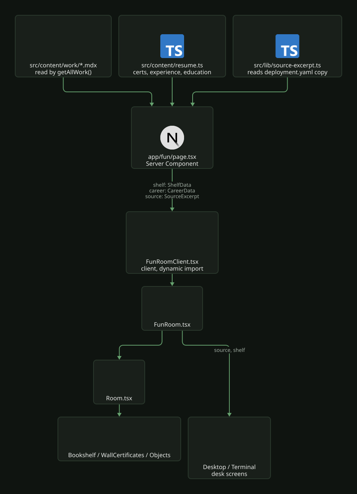

# The fun room

`/fun` is a first-person 3D flat. The flat is the portfolio: every section of the site is an
object. You can walk up to it, look at it and press `E` on it.

The plan is the real apartment, 6.3 x 6.1m, with all four spaces walkable: stue/kjøkken,
soverom, bad and entré. `flat.ts` holds the plan. The wall meshes and the collision boxes are
both built from that one list. A wall you can walk through cannot happen, because you cannot
edit one and forget the other. The flat uses the site's palette, not its real colours
(`docs/apps/portfolio/brand/decisions.md`: the ground is warm near-black, the joinery is dark
oak, and green is only ever a lit point).

The room lives in `portfolio/`. It is dynamic-imported with `ssr: false`. It is never the only
path to anything: every section it shows stays reachable through normal navigation. For that
reason the room does not need to carry SEO and accessibility on its own, and `fun` stands beside
the other nav entries instead of replacing them.

Movement is free by default: first person, WASD, mouse look, pointer lock, collision, and head
bob scaled to the actual speed. A room that moves the visitor itself is only a diagram with extra
steps.

`/infrastructure` stays separate and unchanged. That page's premise is that its claims are
checkable. A 3D room works against that premise. A page labelled "fun" is honest by construction.

Two files outside the feature directories carry room state. `compose.yaml` sets the
`STATUS_FILE` dev env. `src/app/globals.css` holds the `fun-immersive` body class, which hides
the site header and footer while the room is mounted.

---

## Running it

No native node. Everything runs through Docker, wrapped by the Makefile in `portfolio/`.

```bash
cd portfolio
make build          # start the dev stack → http://localhost:3000
make typecheck      # tsc --noEmit
make lint           # eslint
make clean          # tear down, including named volumes
```

Three Docker traps:

`/app/public` is the read-only `cv-bundle` named volume, not the bind mount. A comment in
`compose.yaml` says so. A one-shot service fills the volume once, with a copy of the files in the
image. So anything new under `public/` (models, textures, icons) 404s until you run
`make clean && make build`.

Turbopack's persistence cache is also a named volume (`next-cache`). After you rename a route or
a component directory, every route can return a 404 while the files are present in both the host
and the container. `make clean && make build` fixes it. A plain `make build` does not.

The macOS bind mount can give Turbopack a truncated copy of a file during a write. The result is
a syntax error at a line that is correct on disk. `touch` the file and reload.

---

## File map

All under `portfolio/src/`.

| File | Responsibility |
|---|---|
| `app/fun/page.tsx` | Server component. Reads case studies, certs and career from disk and passes them down. |
| `app/fun/FunRoomClient.tsx` | Thin client wrapper: `next/dynamic` with `ssr:false` is illegal in a Server Component. |
| `components/fun/FunRoom.tsx` | The root: scene composition, lighting, post-processing, HUD, all card state, the loading flow. |
| `components/fun/Room.tsx` | Room shell and furniture: walls, floor, desk, door, lantern, sideboard placement, object placement. Also owns `DESK_SCREEN` / `DESK_TERMINAL` / `CHAIR_Z`, because the stands and the collision boxes have to agree with them. |
| `components/fun/flat.ts` | The floor plan: zones, wall runs with door openings, and the plan-to-world helpers (`at`, `px`, `pz`). Placements are written in plan metres so they can be checked against the drawing. |
| `components/fun/Furniture.tsx` | Sofa and television; the wood stove, the small corner table and its chairs; the kitchen; the bedroom (bed, mirrored wardrobe, over-bed units, fan, poster, blind); the bathroom. |
| `components/fun/Hallway.tsx` | The entré: coat run, shoe rack, and the tall cabinet (`CABINET`) that holds the case studies. |
| `components/fun/Contents.tsx` | What stands inside cupboards, drawers and the fridge, as two instanced meshes. |
| `components/fun/Leds.tsx` | The status LEDs, as one instanced mesh. |
| `components/fun/openable.tsx` | Shared motion for doors, drawers and fronts. |
| `components/fun/Outside.tsx` | The view beyond the windows, built as real geometry for parallax and left unlit. |
| `components/fun/Devices.tsx` | Homelab hardware models, the sideboard, and `HouseDevices`: the smart-home kit placed around the flat. |
| `components/fun/Cctv.tsx` | Looking through the security camera on the TV bench: the lens's render and the feed's overlay. |
| `content/hardware.ts` | Hardware names and specs, transcribed from the repo README. `DEVICES` is shared with `/infrastructure`; `HOUSE` is the room's own. Every entry must have a README row. |
| `components/fun/Bookshelf.tsx` | Case studies as books (`ShelvedBooks`), laid out into the hall cabinet's bays from array length. |
| `components/fun/WallCertificates.tsx` | Certificates standing on wall boards by the desk. |
| `components/fun/Objects.tsx` | The note on the fridge door, contact card, gym bag, career album, service leaflets. Nothing in here hangs on a wall; see the file header. |
| `components/fun/Abacus.tsx` | The skills, counted on an abacus on the dining table. |
| `components/fun/RepoShelf.tsx` | The projects: a wall-hung shelf of 4 x 3 compartments beside the blog covers, one object per repo in `content/repos.ts` `projectRepos`. Builds the repo card and runs the objects' loops. |
| `components/fun/repo-objects/` | One object per repo, built from the repo's icon in its colours, each with its own loop. `shared.tsx` holds `paint`, `Plinth`, `useExtrude` and `useTick`; `index.ts` maps repo names to objects. |
| `components/fun/PrintedPosts.tsx` | The newest blog covers, framed together on the wall. Lays itself out from `/api/v1/blog`. |
| `components/fun/Printer.tsx` | The CV printer: a screen on the lid toggles the CV customizer's flags, and printing downloads the matching PDF while a sheet carrying its page one (`preview` in `cv-manifest.json`, rendered by Ghostscript in the Dockerfile's `pdfbuild` stage) feeds out. |
| `components/fun/Touch.tsx` | Phone controls. `TouchLook` (inside the Canvas and inside `InteractionProvider`) does drag-to-look and tap-to-activate; `TouchStick` is the DOM walk stick. |
| `components/fun/Sonos.tsx` | The speaker on the sideboard and the Web Audio rickroll it plays. No audio files: melody and drum kit are synthesised. |
| `components/fun/Sleep.tsx`, `components/fun/Visitor.tsx` | Lying down on the bed, and who turns up if you stay there after the alarm. |
| `components/fun/Terminal.tsx` | The shell on the portrait desk monitor. |
| `components/fun/Desktop.tsx` | The landscape desk monitor as a GNOME-style desktop: Files, a browser with mock Argo CD and Grafana, Room controls, a text editor with real source from this repo, Mines and Snake. |
| `components/fun/Screen.tsx` | Monitor mesh and DOM panel mount. `Screen` is one panel; `Dashboard` is the television carrying six at once; `PanelCard` is the chrome both share. |
| `components/fun/Panels.tsx` | Content of the live infra panels. Authored at one size (640x376); the television scales them down, so there is no second "small" variant to keep in step. |
| `components/fun/feed.ts` | `/api/v1/infra` polling and staleness rules, `useRepos` and `useProjectRepos`. |
| `components/fun/interaction.tsx` | Look-at-and-press: raycast registry, `Interactive` wrapper. |
| `components/fun/StaticMerge.tsx` | Wraps `Room`: after mount, draws the static meshes as one mesh per material and hides the originals. `NO_MERGE` is the opt-out. |
| `components/fun/Hud.tsx` | Aiming dot, look-at prompt, keybinds, `InfoPanel` sheet. |
| `components/fun/LeaderLabel.tsx`, `components/fun/Marker.tsx` | The house annotation device the prompts are built from, and its brass marker. |
| `components/fun/RoomIntro.tsx`, `components/fun/RoomLoading.tsx` | The desktop intro card and the loading screen, sharing one poster backdrop. |
| `components/fun/FirstPerson.tsx` | WASD, collision (`BLOCKERS`), head bob. Writes the camera position every frame it is enabled, `y` included: anything else that moves the camera has to switch it off first. |
| `components/fun/props.tsx` | Scanned glTF prop loader (`Prop`). |
| `components/fun/shelf.ts` | Shared data types for shelf and career. |
| `components/materials/surface.ts` | PBR surface loader (`useSurface`), shared with the shelf and the bench. |
| `components/materials/paper.ts` | `PAPER` stock and ink ramp, so every printed surface in the room is the same sheet. |
| `components/materials/StudyEnvironment.tsx` | The site's IBL. Shared with the shelf, the bench and the resume object. |
| `components/materials/oak.ts` | `OAK` tints, so every oak surface on the site is the same plank. |

Assets: `public/textures/shelf/` (shared with the home page), `public/textures/fun/`,
`public/models/fun/` (meshopt geometry and WebP maps), `public/icons/social/`. Surfaces and
models are CC0 from Poly Haven. The room credits them bottom-right. No HDRI ships:
`StudyEnvironment` builds the probe from two `Lightformer`s at no byte cost. Measure the cold
`/fun` payload against `make run-prod` on a port the browser has never seen. Never measure
against the dev server, and never on a port that served an older build.

---

## How data reaches the room

The page is a Server Component, so it can read content from disk. It then hands plain data to
the client: `ShelfData`, built from `getAllWork()`, `CareerData`, from `resume.ts`, and
`SourceExcerpt`, a copy of the portfolio `deployment.yaml` from `src/lib/source-excerpt.ts`.
There is no API route for room content. Do not add one.

[](../../assets/diagrams/portfolio-fun-room-data.svg)

Live data is different. `feed.ts` polls `/api/v1/infra` every 60s. It uses the same snapshot and
staleness rules as `LiveStatus` on `/infrastructure`. It also holds `useRepos`, which the
desktop's Files app reads, and `useProjectRepos`, which the repo shelf reads. Both share one
request to `/api/v1/github`. That route makes one GitHub list request an hour and returns the
pinned repos (`repos`) and the shelf's projects (`projects`). `PrintedPosts` fetches `/api/v1/blog` once when the room loads,
because the covers must be in place before a visitor walks up to the wall.

Locally, `compose.yaml` sets `STATUS_FILE=/app/dev/status.json`. Then `/api/v1/infra` takes the
same code path as in the cluster, against the fixture in `portfolio/dev/status.json`. Keep the
fixture's shape identical to the publisher's shape. With a different shape, the panels look
correct locally and break in production. Every field stays optional in all cases: a missed
publish must degrade, not throw.

The status payload's top-level `apps` is not the room's application list. It is the KEDA sleeper
rollup, an object. The per-application rows are at `gitops.applications.list`. Certificates are
at `security.certs.list`. `capacity` is its own top-level object.

---

## Adding things

### A new interactive object

Wrap it in `Interactive`. `label` is the name shown when the visitor looks at it. `detail` is
the second line. `verb` follows `E`.

```tsx
<Interactive label="the thing" verb="read" detail="what it is" onActivate={() => onOpenCard(card)}>
  {(hovered) => <mesh>…</mesh>}
</Interactive>
```

The helpers at the bottom of `FunRoom.tsx` (`hardwareCard`, `bookCard`, `certCard`) build the
cards. One `InfoPanel` renders them. Add a builder, not a second panel.

Touch needs nothing extra. A tap resolves through the same registry and the same `REACH`, so
anything reachable with `E` is reachable with a finger. `verb` must read correctly after both
"E" and "tap to". That is why all verbs are bare infinitives: "read", "open", "take one".

`InfoCard.tags` renders 10px chips sized for stack labels. A sentence in a chip looks like a
layout accident. The services leaflets therefore drop their bullets and link out to the section
instead.

### A new device

Every device in the README hardware tables is somewhere in the room. The room must never claim
hardware that the README does not list. Add the model to `Devices.tsx`. Add its entry to
`content/hardware.ts`, copied from the README row. Then wrap the placement in
`<Inspectable hw={located(entry, "where it stands")}>`. The location becomes the card's last row.

Kit in the cabinet goes in `DEVICES`. `/infrastructure` also renders that list, as one chip per
entry and as models on its bench, so an entry there also needs a model on that bench. Kit
elsewhere in the flat goes in `HOUSE`, and `HouseDevices` places it in plan metres. Anything
under about 5cm gets a `Spot` with an invisible `hit` box. Without it, nobody can put a
crosshair on the item.

The security camera is the exception to the card: when you press it, you look through it.
`CctvView` renders the scene from `CCTV_LENS` after the composer. So the room's own camera never
moves, and the body that stands there is the visitor's. While the feed is up, the body keeps its
head (`whole`). `.room-cctv` hides the screens' DOM layers, because they are placed for the
visitor's eye.

### A new terminal command

One `switch` case in `useCommands` in `Terminal.tsx`. `curl` only accepts same-origin `/api/`
paths. Keep that rule.

Commands that report cluster state read the `data: PanelProps` that the shell receives. They
never fetch on their own. Two pollers on their own schedules will disagree at some point, and a
shell that contradicts the television one desk away is worse than no shell.
`kubectl get applications|nodes|certs` is the worked example. Each of its branches also prints
how much to trust the output (stale feed, or build-time snapshot). A bare table presents old
data as good, and the room's rules forbid that. Keep output inside 60 characters. The portrait
monitor wraps past that.

### The desk computer

The landscape monitor is a small desktop (`Desktop.tsx`). It needs no overlay. E zooms onto it
with `ScreenFocus` and releases the pointer, in the same way as the shell and the printer screen.
Its `Html` takes clicks only while zoomed. From across the room it is a screen with a browser
open on it.

Its apps must not become a second website inside the website. They act on the room (Room
switches the real lamps and the TV channel), or they link out to the page that owns the content.
Files opens case studies, blog posts and repositories in a new tab, and lists certificates by
name. Never copy the body of a case study or a post into a window. The browser's Argo CD and
Grafana are mock interfaces, drawn over the same `PanelProps` that the television reads. The
status line says so.

Desktop state lives in `DesktopScreen`, above the `Html`, for the same reason as the old monitor
tab: drei renders `Html` children in their own root. Window dragging divides pointer deltas by
the rendered scale, because a desktop pixel is not a screen pixel once the desktop is laid into
the room.

### A new blog post

Nothing to do here. Publish the post. The framed covers pick it up from the RSS feed on the next
load. Hugo emits the cover as `<media:content>`, and `/api/v1/blog` reads it.

### A new repository

Add it to `projectRepos` in `content/repos.ts`, in shelf order. Build its object from the
repo's icon in `components/fun/repo-objects/` and add it to `REPO_OBJECTS` in `index.ts`. A repo without an
object gets a plain box. The shelf holds 12. See the BACKLOG entry "Fun room: the repo shelf
holds 12 projects and no more".

An object stands on its compartment floor at the origin, +z towards the room, inside 0.19
wide, 0.22 tall and 0.16 deep, on a `Plinth` in the icon's tile colour. Its colours come from
`paint` in `shared.tsx`. Its loop
goes in `useTick`, computed from the clock, so the shelf can stop it and pose it still.

### A new case study, certification or social link

Nothing to do in the room's code. Add the item to `src/content/work/*.mdx`, `resume.ts` or
`site.ts`, and it appears. Books and certificates lay out from the array length. The note on the
fridge sizes its rows from `site.socials`. The hall cabinet's bays are full at the current count.
See the BACKLOG entry "Fun room: the hall cabinet holds 13 case studies and no more". A new
social also needs a mark in `public/icons/social/` and an entry in `SOCIAL_ICON` in
`Objects.tsx`.

Book width, height, colour and lean are hashed from the slug, never randomised. So a case study
is always the same book in the same place.

---

## Rules

### Geometry and placement

Furniture is placed in plan space, and its collision box is placed twice. Every piece in
`Room.tsx` is positioned with `at(x, y, z)` in plan metres. Every solid piece needs a matching
entry in `BLOCKERS` in `FirstPerson.tsx`. The walls are derived from `wallBoxes()`, so they
cannot drift. The furniture is not derived, so check a new piece both ways. When you rotate a
piece, its half extents swap.

Anything positioned against furniture reads the furniture's numbers. The monitor stands and the
chair's collision box are placed from exported constants, never from copied coordinates.
Otherwise a chair moved against the desk leaves its blocker behind.

A monitor pair is one object. It is placed from one origin, with the bezels almost touching, and
centred on the chair. The arithmetic uses `width·cos(toe-in)`, because a toed-in screen occupies
less of the desk than its width.

Detail must be real geometry. A recess laid on a solid box looks like a solid box. A 5mm
decorative step disappears under any light. The door leaf is a frame of stiles and rails. The
sideboard carcass is five panels with an open front.

Depth offsets in a rotated group flip sign. In a group rotated 180° onto the far wall, the local
`-z` points into the wall. Write offsets as "away from the wall", not as a raw axis.

When a scanned asset includes the thing it stands in (a plant with its pot), take the asset
whole. Do not parent hand-built parts under scanned ones. `Prop` in `props.tsx` measures each
model's bounding box after load and seats the model on its own base, because scanned assets
share no convention for origin or units. One scanned object beside hand-built ones makes the
hand-built ones look worse, not better. So the room stays hand-built, except where a scan is
clearly better.

### Looking and interacting

Anything meant to be looked at presents a face to the room. The face is big enough to put a
crosshair on, and the object is a thing somebody would own. A horizontal surface is only
targetable from directly above, and no standing visitor is there. Books work at ankle height
because they stand upright. A legibility rule alone would approve a UI panel screwed to a living
room wall. That is the failure `docs/apps/portfolio/brand/art-direction.md` names.

Content shrinks with its carrier. Small objects carry a label. The card behind `E` carries the
full content.

Check occlusion, not only existence. A labelled object that you cannot put a crosshair on does
not exist. The Hue Bridge, the certificates and the access point have each been hidden behind
something else. The television stands off the sideboard's centre line for this reason.

An interaction target must not be the thing that moves. If the target is a door that swings
away, the door leaves the crosshair and cannot be closed again. Target a fixed invisible face
instead.

Movement and picking stop whenever anything has focus. The key handlers are on `window`. Without
that gate, WASD keeps walking while a card or the shell has the keyboard.

When you leave a card, the shell or the camera feed, the pointer locks again (`relock` in
`FunRoom.tsx`). Esc is the exception. `requestPointerLock` needs transient user activation. A
click, E or Enter carry it, and Esc never does, so after Esc the next click locks. Until that
click, `FreeLook` in `FirstPerson.tsx` turns the view from plain mouse movement, and the card's
button shows E as the exit that keeps the lock.

Icons are vector, not geometry. Logos built from primitives are unreadable at any sensible
distance. Use real SVG through drei `Html`, the same method the monitors use for text.

Anything that needs the pick registry sits inside `InteractionProvider`, not only inside the
`Canvas`. Mounted outside it, `TouchLook` renders and drag-to-look works, but every tap does
nothing, with no error, because `useActivateAt()` reads a null context.

`RegistryCtx` must not carry hover state. A new identity re-runs every registration effect, the
effect's cleanup clears the hover, and the prompt never settles. Targets register a ref, not a
value, so inline `onActivate` closures do not re-register on every render. Both rules are
commented in `interaction.tsx`. Do not "simplify" them.

Two things must not drive the camera at the same time. `ScreenFocus` eases the view in to a
screen, and back out when you leave. It serves the shell on the desk and the printer's lid screen
(aimed through `PRINTER_SCREEN`, because only the laid-out printer knows where the screen is).
`paused` covers the way in. On the way back, the screen's flag is already false, so `FirstPerson`
would take the camera in the middle of the move and snap it to eye height. The `settling` flag
gives the focus a window that nothing else may touch. The return pose is captured, not
recomputed. A move to a "sensible" spot would relocate the visitor without their notice.

### The repo shelf

Each object is its repo's icon, made physical, in the icon's own colours. It stands on a low
plinth in the icon's tile colour. This is the one place in the flat where the four-material rule
and the glow rule do not apply: the owner chose recognisable icons over the room's palette for
this shelf. See the logbook in `brand/decisions.md`. Everywhere else the rules hold.

- An object copies the shape and colours of the icon in the repo (`assets/icon.svg` or the app's
  own icon). A new repo icon means a new object.
- Each object runs one short loop that shows the project at work. No counting numbers, and no
  text that appears letter by letter. The CV lines fill in a whole line at a time.
- No new lights. A glowing part is an emissive material (`paint(colour, { glow })`), never a
  `pointLight`: a new light would recompile every material in the room.
- One `useFrame` in `RepoShelf` runs every loop, and only while the shelf front can be seen
  (`useSeen`). Reduced motion poses every object at one still frame. Pick that frame so
  nothing hangs in mid-air.
- The crosshair target is a fixed invisible face across each opening, never the moving part.
- Moving parts carry `NO_MERGE`. Colours come from the shared `paint` cache, so equal colours
  share one material and merge.
- The paper labels are tinted down. Untinted paper this close to the hall lamp blooms.

### Screens and DOM layers

Screen content is real DOM, not textures: drei `<Html transform occlude>`. Text stays crisp at
any distance, and the screens reuse real React components. In transform mode, drei sizes the DOM
at `distanceFactor / 400` world units per CSS pixel. So the factor is derived from the screen's
physical width (`distanceFactor` in `Screen.tsx`), and the `scale` prop stays off. Otherwise the
two compound.

Screens have physical sizes and are furniture, not slots: two monitors on the desk (one
landscape, one portrait for the shell) and the television, which carries the observability wall
in a grid. Panels are cheap. Screens are not, and a screen that nobody stands in front of is a
live DOM layer composited for no one. All panels stay mounted. If the room grows past a dozen
screens, cull by distance and view angle together. Distance alone darkens the wall you face.

Text on a screen has a measurable width budget. The shell's help output is two columns held
apart with `padEnd`. It looks aligned only while every line fits on one row. `PORTRAIT_PX_W` is
derived from the mono face's advance (0.6em), the longest line and the padding. Measure it in
the browser. Check it against the face in `layout.tsx` whenever the font changes.

drei's `Html` is patched (`portfolio/patches/@react-three+drei+*.patch`, applied by
`patch-package` on install). Upstream, it unmounts its inner React root synchronously in a layout
effect. React warns about that on every StrictMode mount. Also, a second root created on remount
can null the refs that the first one attached. A remounted layer then loses its DOM, and the
screen shows a bare occlusion hole. The patch defers the unmount past the commit. A remount that
arrives first cancels the unmount and keeps the live root. A drei bump that changes `web/Html.js`
fails the install until the patch is redone.

`Html` attaches to `events.connected`, which r3f sets only after its first commit. Screens
mounted outside the Suspense boundary wait for it (`connected` in `Scene`). Otherwise they mount
against the canvas parent and move a frame later. Every screen also passes its own `geometry` for
the blending hole. Without one, drei sizes the hole from the DOM, and a layer that never lays out
leaves a 1x1m black square.

An `Html` layer laid flush with its own backing box tears. If you put it exactly on a plate's
front face, z-fighting produces a diagonal rip that looks like a shader bug. Everything drawn on
a plate must clear the plate.

A transparent `Html` layer shows its own occlusion plane. `occlude="blending"` lays a plane
behind the DOM. Behind transparent DOM, that plane is a dark rectangle that floats in the air.
Give every blended layer an opaque background. That is why the socials are a note held by
magnets, not bare magnets.

An unlit mesh behind a DOM layer is a black rectangle. Where a DOM layer is the face of an
object, paint the face in the DOM, because scene lighting does not affect the DOM. Tint it warm.
Pure white is the only cold bright thing in a room lit at nine in the evening, and it looks like
a hole in the wall.

Everything printed in the room is `PAPER` from `materials/paper.ts` (the brand `paper` token). A
DOM layer is unlit, so what you write is exactly what renders, against walls that are far darker
under lamplight.

A foreign product's palette does not come with its data. Data borrowed from a service (for
example GitHub repositories) is still drawn in this room's materials: `PAPER` for the sheet,
brass for the fittings, and green only where the spec allows a point.

### Light

Ambient light destroys shape. Light from all directions at once flattens the gradient that shows
the shape of a thing. Keep `ambientLight`/`hemisphereLight` low. Put brightness in fittings that
have a direction and fall off. The current values live in `Lighting` in `FunRoom.tsx`.

Warmth is a relationship, not a value. If you tint every source amber, the ambient light
included, the result is a uniform sepia in which nothing looks lit. Keep the fill cooler, and
make only the fittings warm.

Several pools of light are better than one. One bright source leaves the rest of the room dark,
and invites the fix of more ambient light, which ruins it. The room runs small warm fittings
(lantern, desk mushroom, stove), plus low warm fills for the rooms where no fitting stands. The
stove is the only source that is allowed to move. `FireLight` beats two sines against each other
every frame. It can afford that because it casts nothing.

Emissive surfaces in front of their own lamp clip to white. A light base colour that is both lit
and emitting sums past what ACES can hold. Emit from a near-black base (the lantern uses
`#2a1405`), and the panel keeps its colour at any brightness.

A fitting must not shadow the room from a light that it encloses. Frame members that surround a
light source do not cast shadows. The members side-on to it do, like the lantern's corner posts
that stripe the floor pool.

### Body, mirrors and household stuff

The visitor has a body (`Body.tsx`), driven only from the camera. Position, facing and speed
pick the clip. Crouching or a seat uses Sitting. The body casts no shadow: the shadow map is
drawn on demand, and a caster that moves every frame would redraw it every frame. The neck bone
is collapsed for the visitor's own view and restored for the mirrors, per render. The neck
subtree's matrices are refreshed by hand, because the scene's matrices are updated once a frame.

The three mirrors (wardrobe, hall arch, bathroom cabinet) are `LiveMirror`/`SharpReflector` from
`Mirror.tsx`. Each live reflector is a full extra render of the flat. So a pane is only live
while the visitor can see it (`useSeen`): in front of it, within 8m, in the frustum, and with a
clear line through the interior walls from the eye to its centre or a corner. That keeps the
pane live through a doorway and off behind a wall. The two small bathroom panes render at half
resolution.

The TV remote is picked up, not pressed. In hand it is `HeldRemote`, placed from the camera at
priority 0.4 so it does not trail a frame. The television is then the target that changes the
channel. While the remote is not in hand, that target is disabled. Q lays the remote on the first
upward-facing surface that the crosshair finds within reach (the body and the remote itself are
skipped), turned the way the visitor faces. If the crosshair finds a wall or nothing, the remote
stays in hand. T throws it (`ThrownRemote`): gravity, and a ray along each frame's step. It lands
on the first upward face and bounces off any other face with most of its speed gone. The ray only
runs while the remote is in the air. The keys stay on screen in their own line while the remote
is held, except for the caption slot, which every passing line takes over.

After the observability channels, the television carries `EXTRA_CHANNELS` from `TvChannels.tsx`:
a news channel that mixes jokes with the live feed, sakte-TV, a bouncing-logo screensaver and
Snake. Each one only animates while it is on. P starts Snake while its channel is up and the
remote is in hand. Snake pauses the room and takes every key until Esc. The best score lives in
the visitor's own localStorage.

The washing machine has Maxwell the cat in it (`DancingCat` in `Cat.tsx`). He dances on the drum
floor while the door is open. `Door` reports open and shut through `onToggle` for that. He is
fetched the first time the door opens, never with the room. His group is `NO_MERGE`. Otherwise
the static merge would bake him where he stood at mount. He is a black cat in an unlit drum, so
his material is glossier than the export's, with a faint emissive lift. A real drum light would
add a light to every material in the room.

The microwave's turntable carries a small Norwegian town (`MicroTown.tsx`): houses around a ring
road, a church, spruces, lamps and a car that does laps. The town turns while the door is open.
It is hand-built, and `NO_MERGE` for the same reason as the cat.

The four paintings are `Painting` from `Paintings.tsx`, drawn on a canvas. Each hides an egg that
E only hints at. The live feed's uptime history notches the fjord's far ridge, so the painting
redraws when that history changes. The aurora's moon shows tonight's phase.

Info cards take their icons from `cardIcons.ts`: brands through the site's own registry in
`work/brand-icons.ts`, plus the room's web stack and the card's row keys. Every kicker, row and
tag gets an icon, with a neutral glyph as the fallback. A bare 0 to 100 value renders as a bar.

Household things that are not portfolio content sit in `MyStuff` (from `Contents.tsx`, and
every `Items` stock already does). They are pickable, and pressing E gives a refusal. Static
geometry that the crosshair must not see through is an `Occluder`: every `OpenBox` carcass and
the wardrobe's fixed leaf. An occluder is a disabled target. It blocks what is behind it, never
wins a tie, and stays in the static merge. Without it, the contents of a closed cupboard are
pickable through its side.

### Performance

Set `castShadow={false}` on anything small inside furniture. The main light is a point light, so
its shadow map is a cube, and every caster renders six extra times.

Rounded boxes come from `components/scene/RoundedBox.tsx`, never from drei. drei extrudes
the box and re-runs the crease pass on every instance as it mounts. The local one builds the
grid directly on the rounded surface, runs the crease pass on the indexed grid, and builds
each size once. The crease pass stays: it gives the large wood tops their soft highlight.

Profile before you fix. Bisect with the component removed (verify that it is gone). N8AO is the
dominant post cost. It stays, because it is what makes objects look like they rest on things.
The dpr cap (`[1, 1.5]`) and `multisampling={2}` are the chosen trade-offs. Shadow caster count,
live DOM layers and the interaction raycast have measured free. Do not "optimise" them without a
measurement first. Always state the pixel count, not the window size. Read the true figure from
`gl.domElement.width * height`.

Anything that changes after mount must opt out of the merge. `StaticMerge` bakes every static
mesh into one mesh per material, once, when the room mounts, and hides the originals. A mesh
whose transform or material changes later looks frozen. `Interactive` carries `NO_MERGE`, which
covers everything picked, hovered, opened or switched. Meshes with a `visible` prop, transparent
or shader-patched materials, instanced meshes and anything mounted later are skipped on their
own. A new animated mesh outside an `Interactive` needs `userData={NO_MERGE}` on it or on a group
above it, as `Marker`, the printer's sheet and the running water have.

The parts of an `Interactive` that never move or change material go back into the merge under
`MERGE_STATIC`: a device's body, the lantern's frame, a certificate's print, the chair. They stay
pickable because the hover raycast also walks hidden meshes. A filter on `visible` would make
every merged carcass unaimable. A part whose material follows `hovered` or a switch (the frame
that lights up, the lantern's paper, the tap's lever) stays outside the group. A `NO_MERGE`
nested inside one excludes its subtree again. When the whole part lights up, as a book's spine
does, the part merges, and the hover shows a lit copy over it (`visible={hovered}`, drawn with a
polygon offset so it wins the depth test).

Door and drawer leaves move, so they cannot be baked. They are not drawn one by one either.
`Door` and `Drawer` tag the group they animate with `MERGE_LEAF`. `StaticMerge` draws every leaf
mesh through one `BatchedMesh` per material for the whole flat, and each instance follows its
leaf's transform. The originals stay hidden and pickable, as with the static merge. The rule is
the same one level down: nothing inside a leaf may move or change material relative to the leaf
after mount, unless it has a `NO_MERGE` or a `visible` prop.

Status LEDs blink, so they cannot merge either. `Led` in `Leds.tsx` is only an anchor that
registers itself. `LedField` draws them all as one instanced mesh with a per-instance opacity
attribute, updated from one `useFrame`. The field reads each anchor's position once, so never put
an `Led` on something that moves. It holds `MAX` LEDs and skips any past that, with no warning.

A reflector is a second copy of the flat. drei's `MeshReflectorMaterial` renders the whole scene
from a mirrored camera every frame, so the floor is a plain standard material. The wardrobe
mirrors are real, but they are live only inside `MIRROR_LIVE` in `Furniture.tsx`. Outside it,
`<Activity>` hides them and a dark metal stand-in shows. Hide them, never unmount them. drei
does not dispose its render targets, so every remount leaks GPU memory.

Anything that suspends (`Environment`, `useTexture`, `useGLTF`) sits inside the same `<Suspense>`
as `EffectComposer`. Otherwise React tears the Canvas subtree down during the load, and the
composer builds against a dead GL context: `Cannot read properties of null (reading 'alpha')`.

### Loading and entry

No fly-in. The room opens with the visitor standing in it. A camera move that you cannot steer
looks like a screensaver. On desktop, `RoomIntro` is a plain loading screen with a rotating joke
(`LoadingJoke`, also on the phone loader) until the room is ready. Then it shows the controls and
the brass-pin hint, and any key or click enters. Only a click can take pointer lock. The lock
needs a user gesture, and the nav click that brought the visitor here does not survive the
navigation. So WASD works immediately, and mouse-look may need one click. Touch visitors get an
entry gate instead.

Progress tracks real assets through `useProgress`. Readiness is gated on the Suspense boundary
resolving (`SceneReady`), not on the percentage. Progress reaches 100 while the last texture is
still uploading.

Preloads run at module scope in `FunRoom.tsx` (`preloadSurfaces()`, `preloadProps()`). That is
before the first render, so they defeat any gate put in front of them. They are skipped for
coarse pointers and started from the touch gate's own button instead. A broken preload is
invisible: everything still loads, only later and one asset at a time. So check the call graph,
not only the export.

The loading screen waits on shader compilation, not on bytes. three.js's `checkShaderErrors`
reads each program's info log, which forces compilation one program at a time on the main
thread. So the Canvas turns it off in production and leaves it on in dev. When the Suspense
boundary resolves, `SceneReady` calls `gl.compileAsync` (`KHR_parallel_shader_compile`), and the
Canvas holds `frameloop="never"` until the compile settles. The hold is necessary: any frame
drawn while programs are still compiling makes three.js wait on them synchronously. After the
compile, `SceneReady` uploads every texture with `gl.initTexture`, one per task, so the first
frame does not upload them all in one blocking call. The room only ever draws into the
composer's linear buffers, so the scene compiles with a render target bound. If it compiled for
the sRGB screen, every program would be rebuilt on the first frame. The composer's programs are
not in the scene. So `compilePost` gathers every material that its passes hold (bloom's blur
passes and N8AO's quads included) and compiles them in the same parallel batch. The passes that
draw into buffers compile under a render target. The last pass, which draws to the screen,
compiles without one. Then `SceneReady` renders the composer once before it reports compiled. So
the shadow-map programs and the composer's buffers are made behind the loading screen, not on
the first frame the visitor sees. An early start of the room's chunk from the nav link or the
Hero's enter button measured no reliable gain, so it is not done.

On phones, the loading screen lights one of the room's fittings over the poster for each real
stage (`LoadStage` in `RoomLoading.tsx`): the lantern when the code arrives, the desk lamp when
the assets are in, the stove while the scene builds. The stove flicker is an opacity animation,
because only the compositor keeps running through the build. The glows are placed in the
poster's own pixels. So a re-cut `public/images/room-poster.jpg` (`make hero-posters`) must move
`LIGHTS` with it if the framing changed.

A lost WebGL context must unmount the Canvas, never re-render it. `postprocessing`'s
`EffectComposer` throws out of `addPass` when it renders against a dead context. That throw
reaches Next's error boundary, which owns the whole page (`app/error.tsx`). `ContextGuard` is an
early `return`, not an overlay over the room, because a change of overlay state alone re-renders
`Post`. No canvas is left to receive `webglcontextrestored`, so recovery is a reload, and the
copy must not promise anything else.

---

## Verifying without a pointer lock

Pointer lock does not work in headless Chromium, and `FirstPerson` overwrites the camera every
frame. To test reachability, make two temporary edits, run the sweep, and then revert both:

```tsx
// 1. expose the camera
function TempCam() {
  const { camera } = useThree();
  useEffect(() => { (window as any).__cam = camera; }, [camera]);
  return null;
}
// 2. park movement
<FirstPerson enabled={false} />
```

Then step a scripted camera across the room and read the prompt out of the DOM:

```js
const read = () => {
  const h = document.querySelector('[class*="top-[calc(50%+30px)]"]');
  return h ? h.textContent.replace(/\s+/g, ' ').trim() : null;
};
```

Sweep from a standing eye height of 1.6m with varying pitch, not from the object's own height.
That is the difference between "reachable in principle" and "reachable by a visitor".

Step with nested `requestAnimationFrame`, not `setTimeout`. Otherwise the sweep takes minutes
and gets killed. Scope the DOM query to the prompt element. The site's command palette indexes
page content, so certificate titles and nav labels are in the DOM whether or not the room shows
them.

Always confirm that the hooks are gone before you commit: `grep -n "__cam\|TempCam" src/components/fun/`.

---

## Before committing

- `make typecheck` clean.
- `make lint` with 0 errors. There is a standing baseline of pre-existing warnings. Group the
  output by file, and do not trust the total. If a file you touched appears, the warning is
  yours.
- Routes 200: `/`, `/fun`, `/infrastructure`, `/work/<slug>`.
- Frame rate stated with its pixel count. Headless Chromium runs at dpr 1, so 1600x1000 there is
  1.6 Mpx. A Retina window of the same size renders several times the work.
- No `__cam` / `TempCam` / `TEMP` left in `src/components/fun/`.
- Commit messages describe the change, with no AI attribution.

`docs/backlog/README.md` tracks the open work on the room, under the "Fun room" and "Fun flat"
entries.
