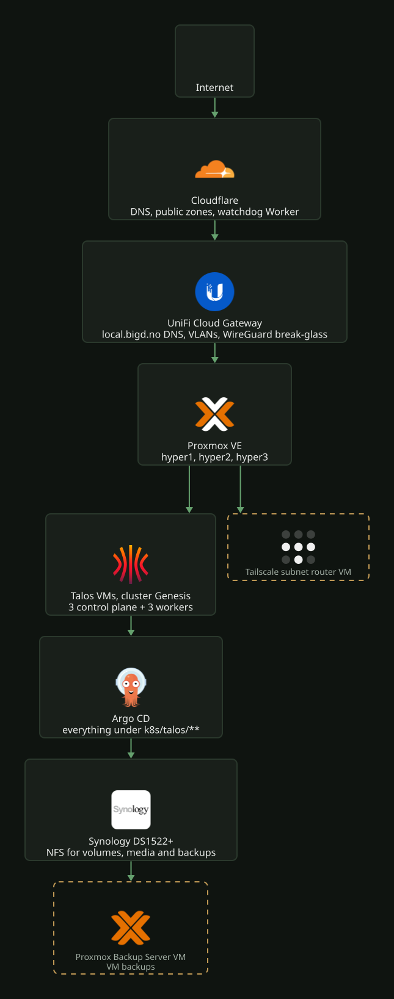

# Homelab technical spec

This file describes the current shape of the homelab: what runs where, and how the parts
depend on each other. It describes the present only. Plans and work in progress live in
`docs/projects/<name>/`. The detail for each area lives in the folders in the map at the
end. The manifests and the Terraform are what runs. When this file and the code disagree,
the code is correct and this file gets a fix.

## Layers

## Physical and virtual

- Three Lenovo nodes run Proxmox VE: `hyper1`, `hyper2`, `hyper3`. The datacenter and
  node configuration is in `terraform/proxmox/hyper-cluster/datacenter`.
- The Talos VMs are in `terraform/proxmox/hyper-cluster/k8s/talos`. `genesis-worker-01`
  on `hyper1` has the iGPU passed through. Plex and Tdarr use it for Quick Sync
  ([`../platform/cluster/gpu-passthrough.md`](../platform/cluster/gpu-passthrough.md)).
- The Synology DS1522+ NAS holds all persistent data. It also runs the Proxmox Backup
  Server VM (`terraform/proxmox/pbs`).
- Home Assistant runs on its own mini PC, outside the cluster. Only its ingress lives in
  this repo. Home Assistant itself holds its configuration.
- Upgrades: [`../platform/cluster/talos-upgrade.md`](../platform/cluster/talos-upgrade.md).
- Every Terraform stack, its Azure state and the laptop-only files it needs:
  [`../platform/cluster/terraform.md`](../platform/cluster/terraform.md).

## Network

- Cilium is the CNI. It announces the LoadBalancer VIPs on L2: Argo CD, the public and
  private Traefik gateways, Plex and innestemme. The addresses are in
  [`../platform/network/README.md`](../platform/network/README.md). Cilium itself is in
  [`../platform/network/cilium.md`](../platform/network/cilium.md).
- Traefik serves HTTP through Gateway API
  ([`../platform/network/traefik.md`](../platform/network/traefik.md)). Public hostnames
  live in Cloudflare. Internal `local.bigd.no` names are aliases in
  `terraform/unifi/dns/records.tf`, not external-dns. A new internal app needs an alias
  there.
- cert-manager issues the certificates
  ([`../platform/network/certificates.md`](../platform/network/certificates.md)). Authentik
  protects the apps that need a login
  ([`../platform/identity/README.md`](../platform/identity/README.md)).
- App namespaces carry CiliumNetworkPolicies. The exception is `home-assistant`, which
  only routes to the external HA box. Cilium enforces the policies, so a missing rule drops
  the traffic.
- Remote access is Tailscale. UniFi WireGuard is the emergency fallback
  ([`../platform/network/remote-access.md`](../platform/network/remote-access.md)).

## Delivery

- Argo CD runs two ApplicationSets, `apps` and `infra`, in `k8s/talos/infra/argocd/`.
  They generate one Application per directory under `k8s/talos/apps/` and
  `k8s/talos/infra/`, synced from `main`. Argo CD reverts a direct `kubectl apply`
  ([`../platform/delivery/argocd.md`](../platform/delivery/argocd.md)).
- `k8s/talos/infra/crds` installs the CRDs that no other Application ships: the
  prometheus-operator CRDs, the VolumeSnapshot CRDs that VolSync needs, and Traefik's.
  Traefik's own chart renders with `includeCRDs: false`.
- Kargo promotes every image built here or in an app repo, except innestemme's. That tag
  is bumped by hand. Portfolio and blog go from stage to prod. headroom demo goes to prod.
  logeverylift, verksted and reelsmith go straight to prod. Every prod promotion is a pull
  request ([`../platform/delivery/kargo.md`](../platform/delivery/kargo.md)). CI only
  builds and pushes tags ([`../platform/delivery/ci.md`](../platform/delivery/ci.md)).
- KEDA with the HTTP add-on scales idle apps to zero. The interceptor wakes them
  ([`../platform/delivery/keda.md`](../platform/delivery/keda.md)).
- GitHub Pages publishes `docs/` to https://docs.nordbye.it
  (`.github/workflows/docs.yaml`). The backlog stays in the repo only.
- Renovate proposes chart, image and provider bumps. It does not propose Postgres major
  upgrades. Those are done by hand
  ([`../platform/data/postgres.md`](../platform/data/postgres.md)).

## Secrets

No secret is committed. Values live in Bitwarden Secrets Manager (Homelab project).
External Secrets Operator turns an `ExternalSecret` that names the item's UUID into a
Kubernetes Secret ([`../platform/secrets/README.md`](../platform/secrets/README.md)).
Reloader (`k8s/talos/infra/reloader`) restarts a workload annotated
`reloader.stakater.com/auto: "true"` when a ConfigMap or Secret that it uses changes.
Outside the cluster, AI agents and scripts reach the same project with their own access
token. `bws-token` (`ai/skills/secrets/`) serves that token on each machine from a copy of
a Bitwarden vault item. The vault itself holds human sign-ins only. Agents never unlock
it.

## Policy

Kyverno checks every Pod for pinned image tags, the baseline and restricted Pod Security
Standards, and resource requests. It writes PolicyReports. All policies are enforced: the
API server rejects a Pod that breaks one, unless the workload has a named exception. CI
attests provenance for the portfolio image. A further policy audits that provenance on
stage. Policy Reporter exports the reports to Prometheus for the SPOG dashboard
([`../platform/policy/README.md`](../platform/policy/README.md)). trivy-operator scans the
image of every running workload for fixable high and critical CVEs and exposed secrets.
It writes a report per container
([`../platform/policy/README.md#vulnerability-scanning`](../platform/policy/README.md#vulnerability-scanning)).

## Storage and data

Storage classes and CSI drivers: [`../platform/storage/README.md`](../platform/storage/README.md).

- `proxmox-local` (Proxmox CSI) for block volumes such as app config.
- `syno-nfs-csi` for shared volumes. A new NFS volume is root-only for non-root uids. An
  app that creates directories in it needs an initContainer chown.
- `syno-nfs-csi-scratch`: the same share with `onDelete: delete`, for the temporary
  volumes of the restore tests.
- Postgres 18 for logeverylift is the CloudNativePG Cluster `logeverylift-db`: a
  primary and a standby, each on an NFS PVC. WAL and nightly base backups go to Garage
  ([`../platform/data/postgres.md`](../platform/data/postgres.md)).
- The CloudNativePG operator (`cnpg-system`) with its Barman Cloud plugin, and a
  single-node Garage (`garage`) as the S3 target for base backups and WAL. Garage keeps
  its data on NFS and its LMDB metadata on `proxmox-local`, snapshotted to NFS
  ([`../platform/data/cloudnative-pg.md`](../platform/data/cloudnative-pg.md)).
- The media share `/volume1/shared-data/media` is one mount, so imports can hardlink
  ([`../apps/media-stack/README.md`](../apps/media-stack/README.md)).
- Backups: etcd snapshots, Postgres dumps, VolSync restic per PVC, Home Assistant, NAS
  snapshots, offsite copy, and PBS for whole VMs
  ([`../platform/backups/README.md`](../platform/backups/README.md), restores in
  [`../platform/backups/restore.md`](../platform/backups/restore.md)).

## Observability

The stack is kube-prometheus-stack, Grafana, Loki with Alloy for logs, and Tempo for
traces. Traefik and logeverylift send traces over OTLP through Alloy. Alloy filters out
monitoring and probe traffic and strips client IPs and query strings. Alertmanager sends
only actionable, critical alerts to Discord. A Cloudflare Worker reports a missing
Alertmanager heartbeat. Falco watches syscalls on every node and posts to Discord itself
through falcosidekick
([`../platform/observability/README.md`](../platform/observability/README.md)). Past
incidents are in [`../platform/observability/incidents.md`](../platform/observability/incidents.md).
OpenCost estimates electricity cost per namespace from Prometheus usage
([costs](../platform/observability/costs.md)).
Pyrra keeps SLOs and error budgets for the public sites over a 28-day window. It pages on
the burn rate of the probe SLO. Kargo reads those budgets from Prometheus before it opens a
prod promotion PR. A low budget stops the auto-merge
([`../platform/observability/slos.md`](../platform/observability/slos.md)).
A k6 CronJob in `synthetics` signs in to logeverylift in Chromium every 10 minutes and
walks the log-a-set flow. It remote-writes the result of each step to Prometheus. A flow
that breaks behind a page that still answers 200 therefore pages Discord
([`../platform/observability/README.md`](../platform/observability/README.md#user-journeys)).
Argo CD notifications writes a Grafana annotation for every finished sync. The Homelab
dashboards draw them as deploy markers
([`../platform/delivery/argocd.md`](../platform/delivery/argocd.md#deploy-markers)).
Grafana reads pull requests from the GitHub API through a GitHub App
([`../platform/observability/README.md`](../platform/observability/README.md#github)). The
same App lets Git Sync load the dashboards under `grafana/` and commit each UI save to a
branch for a PR ([`../platform/observability/README.md`](../platform/observability/README.md#git-sync)).
Grafana also reads Cloudflare's analytics from its GraphQL API with a read-only token
([`../platform/observability/README.md`](../platform/observability/README.md#cloudflare)).
Outside the cluster, Prometheus scrapes the Proxmox API (pve-exporter), node-exporter on
the hosts (CPU temperatures and NVMe health), Proxmox Backup Server (pbs-exporter), the
NAS over SNMP, and the UniFi gateway. Inside the cluster, CloudNativePG's exporter reports
logeverylift's database, and electricity-price supplies the NO1 spot price for the cost
panels of the SPOG
([`../platform/observability/README.md`](../platform/observability/README.md#sources)).
metrics-server (`k8s/talos/infra/metrics-server`) serves the resource metrics API for
`kubectl top`.

## Workloads

23 Argo CD Applications live under `k8s/talos/apps/`, one per directory. These groups
have apps that depend on each other:

- Media: requests, downloads behind a VPN, Plex, subtitles and re-encoding, with a
  separate 4K film library ([`../apps/media-stack/README.md`](../apps/media-stack/README.md)).
- Sites: portfolio and blog. Each has a stage and a prod, and Kargo promotes them
  ([`../apps/portfolio/README.md`](../apps/portfolio/README.md)).
- Own apps: logeverylift (with Postgres), headroom and headroom-demo, reelsmith
  ([`../apps/reelsmith/README.md`](../apps/reelsmith/README.md)), verksted
  ([`../apps/verksted/README.md`](../apps/verksted/README.md)), bigd.
- Hub: `hub.bigd.no` (Homepage) links every app. Its config is
  `k8s/talos/apps/homepage/values.yaml`.

Other apps, one directory each under `k8s/talos/apps/`:

- headroom: `headroom.local.bigd.no`, SQLite on NFS. Do not add `runAsUser`. The image
  starts as root and falls back to root when its chown fails on NFS. A non-root start
  breaks SQLite. `ALLOWED_HOSTS` must list every hostname it is served on, or it answers
  403. headroom-demo is the same image on `headroom.nordbye.it` with fictional data.
- trek: travel planner on `trek.bigd.no`. The admin in `trek-secret` is created only on a
  boot with no users. `ENCRYPTION_KEY` must never change, or the stored secrets become
  unreadable.
- home-assistant: no pod. A Service with hand-written Endpoints points at the HA mini PC,
  `10.3.10.15:8123`, behind `ha.local.bigd.no`.
- audiobookshelf: `audiobookshelf.local.bigd.no`, private gateway. Reach it from outside
  through remote access.
- ollama and open-webui: local LLM chat on `open-webui.local.bigd.no`. ollama is pinned to
  the `hyper3` zone. open-webui reaches it through the `ollama-wake` Service, so its
  requests wake ollama from zero. The model cache is not backed up.
- innestemme: the voice assistant for the Voice PE in the living room. It replaces Assist.
  It dials the device on IoT and serves spoken answers on the VIP `10.3.10.99:9090`. One
  UniFi firewall policy lets the device reach that VIP. Its skills page is on
  `jarvis.local.bigd.no`
  ([`../apps/innestemme/README.md`](../apps/innestemme/README.md)).
- mealie: recipe manager on `mealie.local.bigd.no`, private gateway, SQLite, sign-up off.
- homepage: the hub on `hub.bigd.no`, behind Authentik forward-auth.
- bigd: the static `bigd.no` landing page. nginx serves `index.html` from a ConfigMap.
- omni-tools: a stateless browser tool collection on `omni-tools.bigd.no`.
- isponsorblocktv: skips sponsor segments and ads in the YouTube app on the TVs through
  YouTube's lounge API. It has no route and no volume. The paired screens live in
  Bitwarden ([`../apps/isponsorblocktv/README.md`](../apps/isponsorblocktv/README.md)).

## Doc map

`docs/` has one folder per kind of work and one subfolder per area. The `README.md` of
each area is its current state. Runbooks sit beside it.

| Folder | Contents |
| ------ | -------- |
| [`platform/backups`](../platform/backups/README.md) | backup layers, watching them, [restores](../platform/backups/restore.md) |
| [`platform/cluster`](../platform/cluster/README.md) | Proxmox and Talos, upgrades, GPU passthrough, [Terraform stacks](../platform/cluster/terraform.md) |
| [`platform/data`](../platform/data/README.md) | in-cluster Postgres, major upgrades, CloudNativePG, Garage |
| [`platform/delivery`](../platform/delivery/README.md) | [Argo CD](../platform/delivery/argocd.md), Kargo promotion, [KEDA scale to zero](../platform/delivery/keda.md), [CI](../platform/delivery/ci.md) |
| [`platform/identity`](../platform/identity/README.md) | Authentik SSO |
| [`platform/network`](../platform/network/README.md) | VIPs, [Traefik](../platform/network/traefik.md), [Cilium](../platform/network/cilium.md), [certificates](../platform/network/certificates.md), DNS, Cloudflare, UniFi, remote access |
| [`platform/observability`](../platform/observability/README.md) | monitoring, alerting, [incidents](../platform/observability/incidents.md), the [reliability practice](../platform/observability/sre.md) |
| [`platform/post-quantum`](../platform/post-quantum/README.md) | crypto inventory, [Shor on a real quantum computer](../platform/post-quantum/shor.md) |
| [`platform/policy`](../platform/policy/README.md) | Kyverno policies, Trivy image scanning, their reports |
| [`platform/secrets`](../platform/secrets/README.md) | Bitwarden to cluster secrets |
| [`platform/storage`](../platform/storage/README.md) | storage classes, CSI drivers |
| [`apps/innestemme`](../apps/innestemme/README.md) | the voice assistant for the Voice PE |
| [`apps/isponsorblocktv`](../apps/isponsorblocktv/README.md) | SponsorBlock for the TVs, pairing a screen |
| [`apps/media-stack`](../apps/media-stack/README.md) | requests, storage, 4K, seeding, subtitles, re-encoding |
| [`apps/portfolio`](../apps/portfolio/README.md) | the portfolio site, brand decisions, the fun room |
| [`apps/reelsmith`](../apps/reelsmith/README.md) | the reelsmith publishing gateway |
| [`apps/verksted`](../apps/verksted/README.md) | the agent session sandbox |
| `projects/<name>` | work in progress, created when needed and deleted when it ships |
| [`backlog`](../backlog/README.md) | known gaps agreed to leave for later |
| [`assets`](../assets) | diagrams, logo, social preview |
