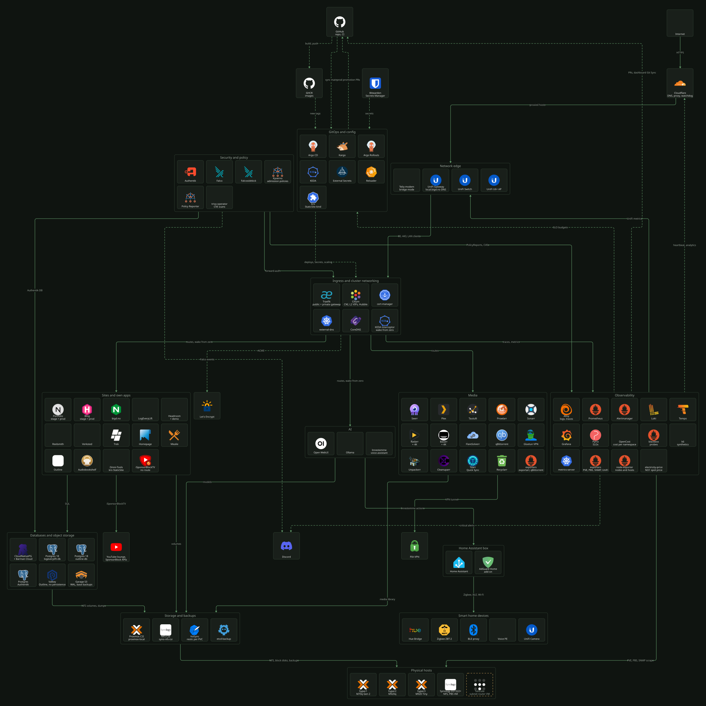
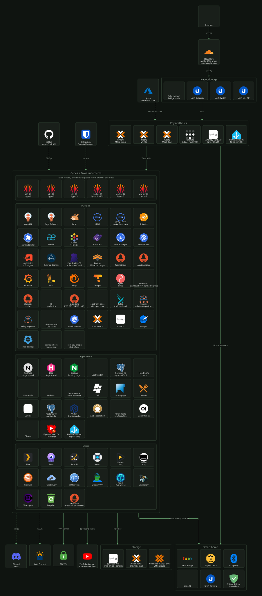

# Diagrams

The homelab has two maps and one diagram for each area. Each diagram is a D2 text file in
[`docs/assets/diagrams/`](https://github.com/mortennordbye/homelab/tree/main/docs/assets/diagrams). A workflow renders every
file on each push to `main`, so the images show what the repo holds now.

This page tells you how to read the two maps, how to go from a box to its docs, and how to
change a diagram or copy the setup into your own repo.

## The two maps

Select an image to open it full size.

### Network and service flow

Which parts talk to each other, and how a request, a deploy, a secret or an alert moves
through the homelab.

[](../assets/diagrams/network-flow.svg)

### Overview

Everything that exists, grouped by where it runs: the network edge, the physical hosts, the
Talos cluster, storage and the smart home.

[](../assets/diagrams/homelab-overview.svg)

## Read the network flow

| Mark | Meaning |
| ---- | ------- |
| Solid line | Requests or data: HTTP traffic, SQL, volumes, scrapes. |
| Dashed line | Control: deploys, secrets, DNS, certificates, alerts. |
| Box with a title | A group. A line goes to the group, not to one card in it. |
| Gold dashed card | A part that is not on the main path, for example the Tailscale VM. |

The groups go from the outside in, top to bottom: external services, GitOps, the network
edge, ingress, the workloads, storage, and at the bottom the physical hosts. Every line
points down. Flows that go back up, such as Kargo pull requests to GitHub or the scrapes of
the hosts, are not drawn, so the lines stay readable. The area docs describe them.

The diagram does not show IP addresses, VLANs or ports. Those are in the area docs, so each
value is written once. Use the table below to go from a group to its docs.

| Group | What it holds | Docs |
| ----- | ------------- | ---- |
| Network edge | Modem, UniFi gateway, switch, access point, `local.bigd.no` DNS | [UniFi](../platform/network/unifi.md), [DNS](../platform/network/dns.md), [Cloudflare](../platform/network/cloudflare.md) |
| Ingress and cluster networking | Traefik gateways, Cilium VIPs, cert-manager, external-dns, KEDA interceptor | [Network](../platform/network/README.md), [Traefik](../platform/network/traefik.md), [Cilium](../platform/network/cilium.md), [certificates](../platform/network/certificates.md) |
| GitOps and config | Argo CD, Kargo, Argo Rollouts, KEDA, External Secrets, Reloader, kro | [Delivery](../platform/delivery/README.md), [secrets](../platform/secrets/README.md) |
| Security and policy | Authentik, Falco, Kyverno, Policy Reporter, trivy-operator | [Identity](../platform/identity/README.md), [policy](../platform/policy/README.md) |
| Sites and own apps, AI, Media | The workloads | [Spec, workloads](README.md#workloads), [media stack](../apps/media-stack/README.md), [innestemme](../apps/innestemme/README.md) |
| Databases and object storage | CloudNativePG, the Postgres clusters, Valkey, Garage | [Data](../platform/data/README.md) |
| Observability | Prometheus, Alertmanager, Grafana, Loki, Tempo, Pyrra, the exporters | [Observability](../platform/observability/README.md) |
| Storage and backups | Proxmox CSI, NFS CSI, VolSync, etcd backups | [Storage](../platform/storage/README.md), [backups](../platform/backups/README.md) |
| Physical hosts | Three Proxmox nodes, the Synology NAS, the Tailscale VM | [Cluster](../platform/cluster/README.md), [remote access](../platform/network/remote-access.md) |

### Follow one request

A public request to `nordbye.it`:

1. The browser resolves the name in Cloudflare. Cloudflare proxies the request to the home
   IP address.
2. The UniFi gateway forwards ports 80 and 443 to the public Traefik gateway, a Cilium VIP.
3. Traefik matches the HTTPRoute and sends the request to the portfolio Service.
4. Traefik sends a trace to Alloy, and Prometheus scrapes the metrics. A failed probe pages
   Discord through Alertmanager.

A private request to `portfolio-stage.local.bigd.no` starts at the UniFi gateway, which
answers the `local.bigd.no` name with the private Traefik VIP. Traefik sends the request to
the KEDA interceptor. When the app is at zero replicas, the interceptor holds the request
until the pod is ready ([KEDA](../platform/delivery/keda.md)).

## Area diagrams

Each area page has its own diagram that shows one part in more detail.

| Area | Page |
| ---- | ---- |
| Layers, from the internet to the NAS | [Spec](README.md) |
| Cluster layout, Talos upgrades, GPU passthrough, Terraform stacks | [Talos](../platform/cluster/talos.md), [upgrades](../platform/cluster/talos-upgrade.md), [GPU](../platform/cluster/gpu-passthrough.md), [Terraform](../platform/cluster/terraform.md) |
| Traefik, Cilium L2 and policies, certificates, DNS, Cloudflare, UniFi, remote access | [Network](../platform/network/README.md) and its pages |
| Argo CD, CI, Kargo, KEDA | [Delivery](../platform/delivery/README.md) and its pages |
| Secrets, Authentik | [Secrets](../platform/secrets/README.md), [identity](../platform/identity/README.md) |
| Signals, traces, alerts, cost, SLOs, the SRE loop | [Observability](../platform/observability/README.md) and its pages |
| Kyverno reports, image provenance | [Policy](../platform/policy/README.md) |
| Postgres, storage classes, backups, PBS | [Data](../platform/data/postgres.md), [storage](../platform/storage/README.md), [backups](../platform/backups/README.md) |
| Media stack, innestemme, reelsmith, verksted, the fun room | [Apps](../apps/media-stack/README.md): one page per app |

## How the diagrams are built

1. The source is a `.d2` file in `docs/assets/diagrams/`. It holds the cards, the groups and
   the lines as text.
2. D2 `v0.7.1` places the cards with the ELK layout engine and writes an SVG.
3. Each card has an icon URL: the software's own logo from
   [dashboard-icons](https://github.com/homarr-labs/dashboard-icons), the Kubernetes resource
   icons for Kubernetes objects, and [Iconify](https://iconify.design) for the rest. D2
   downloads each icon during the render and puts it in the SVG. The repo stores no icon
   files.
4. On a push to `main` that changes a `.d2` file,
   [`render-assets.yaml`](../../.github/workflows/render-assets.yaml) renders every diagram,
   converts each SVG to a PNG with `rsvg-convert`, and commits the images back to `main`.
5. The docs site embeds the SVG. The GitHub README links the PNG, because GitHub serves a raw
   SVG with a content security policy that blocks the embedded icons.

Iconify can refuse the runner with HTTP 429 for some minutes. The workflow then keeps the
committed SVG for that diagram and writes a warning. The next push renders it again.

## Change a diagram

1. Edit the `.d2` file. To add a part, copy a sibling card in the same group and change the
   label and the icon.
2. Render locally with `make diagram`. The target runs D2 in Docker, so you install nothing.
3. Open the SVG or PNG and check the layout.
4. Open a pull request with the `.d2` change. The rendered images on `main` come from the
   workflow.

Rules that keep the layout readable:

- Draw a line from group to group. A line into one card of a grid group stops ELK from
  putting the groups in layers, and the sheet goes flat.
- A line that points to a higher layer is written `upper <- lower`. The form
  `lower -> upper` turns the layers upside down.
- Give each style rule for lines in both forms, `(** -> **)` and `(** <- **)`. Lines without a
  rule get the D2 default colour.
- Keep a diagram that the docs site embeds at 1000 px wide or less. The text column is
  688 px, and a wider image shrinks until you cannot read it. The two maps are wider, because
  you open them full size.
- Use the site colours from `docs/assets/stylesheets/theme.css`. Copy the `classes` block of
  an existing diagram.

A new app on a gateway also gets a card in both maps. The checklist for that is in
[`ai/skills/expose-app/SKILL.md`](../../ai/skills/expose-app/SKILL.md).

## Let an AI agent draft the diagram

An AI coding agent is good at this work. It can read every manifest, Helm values file and
Terraform stack in a repo in minutes. It then lists each component and each connection
between them, and writes the result as D2 text. A person needs hours to do the same audit by
hand, and usually misses a part.

I use this method in my homelab and in my professional work as a platform engineer. In both
places the agent finds the parts that the diagram does not show yet. The person checks the
result.

1. Give the agent the folders that describe the system, for example `k8s/` and `terraform/`.
   Also give it one existing `.d2` file as an example of the style.
2. Ask it for a list first: the parts that run but are not in the diagram, and the parts in
   the diagram that no longer run. Read the list before the agent edits.
3. Let the agent edit the `.d2` file and render it with `make diagram`.
4. Open the image and check it. An agent reads the code, not the live system. A part that is
   in the repo but switched off can still show on the diagram.

A prompt that works:

```text
Read k8s/ and terraform/. List every service, operator and external
dependency that is not in docs/assets/diagrams/network-flow.d2, and every
card in that file that has no code behind it. Do not edit yet.
```

Do not give the agent secrets or a kubeconfig with write access. It needs read access to the
repo only.

## Use the setup in your own repo

You need three things:

1. One or more `.d2` files.
2. The `diagram` target in the [`Makefile`](../../Makefile) for local renders.
3. A copy of [`render-assets.yaml`](../../.github/workflows/render-assets.yaml) without the
   logo step. Change the paths and the `github.repository_owner` check.

A small start:

```d2
direction: down
vars: {
  di: https://raw.githubusercontent.com/homarr-labs/dashboard-icons/main/svg
}

internet: Internet
edge: Network edge {
  gw: Gateway {icon: ${di}/unifi.svg}
}
cluster: Cluster {
  traefik: Traefik {icon: ${di}/traefik.svg}
  app: My app {icon: ${di}/nginx.svg}
}

internet -> edge: HTTPS
edge -> cluster: 80, 443
```

Render it with:

```bash
docker run --rm -v "$PWD:/work" terrastruct/d2:v0.7.1 --layout elk /work/start.d2 /work/start.svg
```
