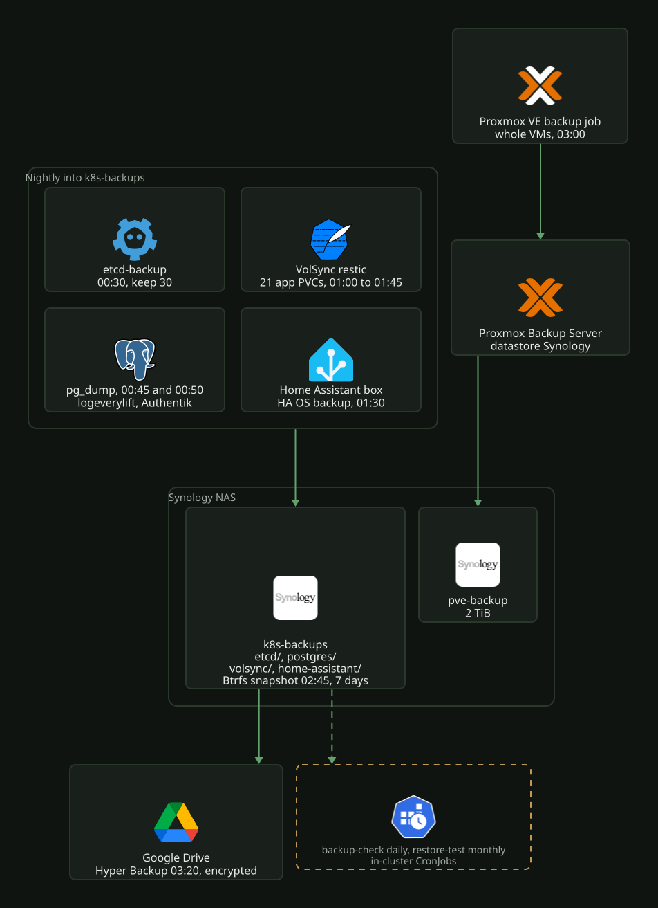

# Backups

Everything except the laptop-only files is written to the Synology share `k8s-backups`
(`nas.local.bigd.no:/volume1/k8s-backups`, Volume 1). Restores are in
[`restore.md`](restore.md). The Proxmox Backup Server itself (datastore, identities,
notifications) is in [`pbs.md`](pbs.md).

## Layers

[](../../assets/diagrams/backups-layers.svg)

| Layer | Source | Schedule (Europe/Oslo) | Kept | NAS path | Defined in |
|---|---|---|---|---|---|
| etcd | `talosctl etcd snapshot` via a Talos API ServiceAccount (`os:etcd:backup`) | 00:30 | 30 | `etcd/etcd-<UTC>.db.gz` | `k8s/talos/infra/etcd-backup/`, patch in `terraform/proxmox/hyper-cluster/k8s/talos/talos-cluster.tf` |
| logeverylift DB | `pg_dump --format=custom`, Postgres 18 | 00:45 | 30 days | `postgres/logeverylift/` | `k8s/talos/apps/logeverylift/db-backup.yaml` |
| Authentik DB | `pg_dump --format=custom`, Postgres 17 | 00:50 | 30 days | `postgres/authentik/` | `k8s/talos/infra/authentik/db-backup.yaml` |
| Outline DB | `pg_dump --format=custom`, Postgres 18 | 00:55 | 30 days | `postgres/outline/` | `k8s/talos/apps/outline/db-backup.yaml` |
| logeverylift DB, point in time | CloudNativePG base backup and continuous WAL archiving to Garage | base backup 00:15, WAL continuous | 30 days | in `volsync/garage/garage-data/` | `k8s/talos/apps/logeverylift/cnpg-cluster.yaml`, [`../data/cloudnative-pg.md`](../data/cloudnative-pg.md) |
| App volumes (23) | VolSync restic, `copyMethod: Direct`, one repository per PVC | 01:00 to 01:55 by namespace | 14 daily, 8 weekly, 6 monthly | `volsync/<namespace>/<pvc>/` | `volsync.yaml` in each app, controller `k8s/talos/infra/volsync/` |
| Home Assistant | HA OS automatic backup (encrypted) | 01:30 | 14 | `home-assistant/` | HA UI, Settings > System > Backups |
| *arr databases | App-native zips inside `/config/Backups` (Sonarr, Radarr, Radarr 4K, Prowlarr) | daily | 14 days | inside the VolSync copy | app UI, see [media stack](../../apps/media-stack/README.md) |
| Whole share | Btrfs snapshot, immutable 7 days | 02:45 | 30 | `k8s-backups` | DSM Snapshot Replication |
| Offsite | Hyper Backup task to Google Drive, client-side encrypted, Smart Recycle 30 versions | 03:20 | 30 versions | Google Drive | DSM Hyper Backup |
| Whole VMs | Proxmox backup job to PBS | 03:00 | 1 daily, 1 weekly, 1 monthly | PBS datastore on `pve-backup` | `terraform/proxmox/hyper-cluster/datacenter/backup.tf` |
| Laptop-only files | zip of the gitignored paths in `.backup-manifest` and the `.gitignore` backup block, over SMB | by hand | 14 | `shared-data` share, `documents/IT/Repo-Hidden-Files-Backups/Homelab/` | `scripts/backup-secrets.sh` |

The laptop-only files are the files that Git never holds: the Terraform stacks'
`terraform.tfvars` and the state `backend.conf`, the Talos `kubeconfig`,
`talosconfig` and `controlplane.yaml`, and a few gitignored working docs
([`../cluster/terraform.md`](../cluster/terraform.md)). The script asks for the NAS
login, reads the zip back to verify it, and keeps the newest 14 zips. To restore, run
`unzip` at the repo root. Nothing checks the age of the newest zip.

## Coverage

VolSync covers: arr-stack (sonarr, radarr, radarr-4k, bazarr, bazarr-4k, cleanuparr, tdarr), gluetun-vpn (prowlarr,
qbittorrent), plex-media-stack (plex, tautulli, seerr), audiobookshelf (config, metadata),
trek (data, uploads), mealie, open-webui, outline (data), headroom, verksted, monitoring (grafana), garage
(data).

Not backed up by design: Loki, Tempo, Prometheus, Alertmanager, the Ollama model cache,
flaresolverr, reelsmith (keeps its own copies), the media itself.

## Secrets needed to restore

| Secret | Where | Opens |
|---|---|---|
| `volsync-restic-password` | Bitwarden, Homelab project | every VolSync repository |
| Home Assistant backup encryption key | Bitwarden (saved by hand) | HA backups |
| Hyper Backup encryption key | DSM Hyper Backup task | the Google Drive copy |

## Watching it

- Grafana SPOG, row `Backups`: age of the last successful etcd and dump job,
  VolSync sources behind schedule.
- Alerts (critical, Discord): `BackupJobStale` (etcd or a dump not successful for 26 h),
  `VolSyncBackupStale` (a source behind schedule for 6 h), `PostgresBaseBackupStale` (no
  CloudNativePG base backup for 26 h) and `PostgresWalArchivingFailing`. DSM failures (Hyper Backup,
  snapshots) arrive as `SynologyNotification` and by email.
- Backups made outside the cluster report failures only. Daily checks in
  `k8s/talos/infra/backup-check/` look for the newest backup at 09:00 and fail when it is
  older than 26 h. `BackupJobStale` covers them. `pbs-backup-check` reads the Proxmox
  vzdump task logs. It fails for any guest in the job with no task finished in the last 26 h
  (the monitoring token may not list PBS backups directly). It also fails when a VM disk
  is stuck as a pending delete. A Proxmox-CSI detach leaves that state when it loses the VM
  config lock. The check prints the `qm set <vmid> --delete <disk>` that clears it once QEMU
  no longer has the device. `ha-backup-check` looks for a
  fresh `.tar` in `home-assistant/`. `volsync-backup-check` fails for any repository under
  `volsync/` with no snapshot file from the last 26 h, whatever the cause. A repository left
  behind by a removed app therefore has to be deleted or archived. Hyper Backup and the DSM
  snapshots have no staleness check.
- `restore-test` runs on the 1st of each month at 10:00: `restic check` with 5 % of the
  data read on every VolSync repository, a full restore of `mealie/data-pvc`, and the
  newest logeverylift and Authentik dumps loaded into a scratch Postgres. It reads the
  NAS only. `RestoreTestFailed` alerts when a run does not pass.
- `logeverylift-db-restore-test` (namespace `logeverylift`) runs on the 1st of each month
  at 10:30 and recovers a temporary one-instance Cluster from Garage to one hour earlier,
  counts tables and rows, and deletes the Cluster. `RestoreTestFailed` covers it too.
- If nothing in the homelab reports, the Cloudflare watchdog reports the missing
  Alertmanager heartbeat to Discord (`docs/platform/observability/README.md`).
- By hand:

  ```sh
  kubectl -n etcd-backup get cronjob,jobs
  kubectl get cronjob -A | grep db-backup
  kubectl get replicationsources -A \
    -o custom-columns=NS:.metadata.namespace,NAME:.metadata.name,LAST:.status.lastSyncTime,RESULT:.status.latestMoverStatus.result
  kubectl -n <ns> create job --from=cronjob/<name> <name>-manual   # run one now
  kubectl -n backup-check logs job/<name>-manual --all-containers   # check and restore-test output
  ```

## Configured outside Git

The `synology-community/synology` Terraform provider has no resources for shares, NFS
rules, snapshots or Hyper Backup. These are set by hand in DSM and recorded here.

| Where | Setting |
|---|---|
| DSM Shared Folder `k8s-backups` | Volume 1, hidden, recycle bin off, data checksum on, compression off, quota 200 GB |
| DSM NFS rule on `k8s-backups` | `10.3.10.0/24`, read/write, No mapping, sys, async, non-privileged ports, mounted subfolders |
| DSM Snapshot Replication | snapshots of `k8s-backups` (schedule in Layers) |
| DSM Hyper Backup | the Google Drive task includes `k8s-backups` |
| NAS folders | `home-assistant/`, `etcd/`, `postgres/{logeverylift,authentik}/`, `volsync/` must exist; static NFS PVs need their path |
| Home Assistant | network storage `k8s_backups` (NFS `10.3.10.10:/volume1/k8s-backups/home-assistant`) as the automatic backup location |

## Constraints

- Only root can read or write `k8s-backups`. With No mapping, the client uid reaches the
  share ACL unchanged, and the ACL denies every other uid, the folders' owner 1026 included.
  The etcd and Postgres dump jobs and the `backup-check` jobs therefore run as root.
  `k8s/talos/infra/kyverno/policyexception-nas-backups.yaml` exempts them from
  `pod-security-restricted`.
- `trigger.manual` on a ReplicationSource replaces its schedule. Neither `VolSyncBackupStale` nor
  ArgoCD notices this. Only `volsync-backup-check` does, up to a day and a half later. After a
  test run, remove the field and check that `nextSyncTime` is set.
- VolSync needs the VolumeSnapshot CRDs installed (`k8s/talos/infra/crds`), even with
  `copyMethod: Direct`. No snapshot controller runs.
- Each namespace with a VolSync source carries `volsync.backube/privileged-movers: "true"`,
  because the NFS export accepts writes from root only. That namespace also has to be in the
  `volsync-movers-root` exception in `k8s/talos/infra/kyverno/policyexception-nas-backups.yaml`.
  Each source and restore sets `moverSecurityContext` (seccomp only) and `moverResources`.
  `runAsUser` stays unset: a non-root mover cannot write to its repository.
