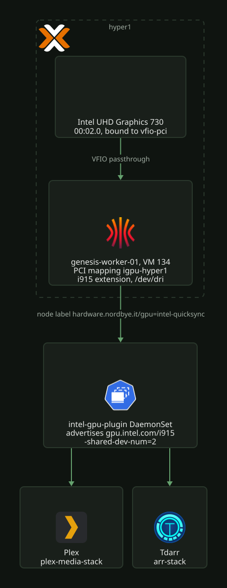

# hyper1 iGPU for Plex and Tdarr

hyper1 passes its integrated GPU through to `genesis-worker-01` (VM 134). Plex and Tdarr use it
for Intel Quick Sync hardware transcoding through the Intel GPU device plugin.

[](../../assets/diagrams/cluster-gpu-passthrough.svg)

Every command is a single line. A tmux session corrupts heredocs and backslash continuations on
paste.

## Facts

| Fact | Value |
| ---- | ----- |
| Device | `00:02.0` Intel RocketLake-S GT1 [UHD Graphics 730], `8086:4c8b` |
| Subsystem | Lenovo `17aa:31a7` |
| Host CPU | i5-11400T, 11th gen. hyper2 and hyper3 are 8th gen |
| Quick Sync | H.264, HEVC 8/10-bit, VP9, AV1 decode. hyper1 is the only host with AV1 |
| IOMMU | Enabled by default, no kernel cmdline change needed |
| IOMMU group | Group 0, the GPU is the only device in it |
| SR-IOV | Not advertised |
| Render node | `renderD128`, mode `crw-rw-rw-`, so no privileged container or extra groups needed |

## Constraints

Rocket Lake is Gen12. Intel dropped GVT-g after Gen11, and the device does not advertise SR-IOV.
The GPU therefore cannot be shared between VMs. It is a full VFIO passthrough to exactly one VM,
and hyper1 loses it completely. It goes to a worker, not to `genesis-ctrl-01`, which also runs on
hyper1. The control plane then has no dependency on one physical machine.

Passthrough pins all RAM of the guest. hyper1 has 31 GiB. `genesis-worker-01` (16 GiB) and
`genesis-ctrl-01` (8 GiB) leave the host a small margin. A raise of `memory_mb` on either VM takes
memory from the host.

The host reboot must come before the Terraform attach. The addition of `hostpci0` is not a staged
config edit. The provider stops the VM, writes the config and starts the VM. That start fails
unless the device is already bound to `vfio-pci`.

## Rebuild hyper1

### Host preparation

On hyper1. Do not reboot yet.

```bash
echo 'options vfio-pci ids=8086:4c8b disable_vga=1' > /etc/modprobe.d/vfio.conf
```

```bash
echo 'blacklist i915' > /etc/modprobe.d/blacklist-i915.conf
```

```bash
printf 'vfio\nvfio_iommu_type1\nvfio_pci\n' >> /etc/modules
```

```bash
update-initramfs -u -k all
```

Read that output. It lists every installed kernel. GRUB boots the newest one by default, and the
machine has no IPMI.

### PCI mapping

`terraform/proxmox/hyper-cluster/datacenter/hardware.tf` declares the `igpu-hyper1` mapping, and
that stack applies it. Its name must match `pci_mapping` in the Talos `terraform.tfvars`. A
mapping is used instead of a raw PCI id because the provider's `hostpci.id` does not work with API
token auth.

Both `iommu_group` and `subsystem_id` are required. Proxmox accepts a mapping without them, then
rejects it at VM start with `missing expected property`. It reports one property per failed start,
and the VM does not boot. The values come from `ls /sys/kernel/iommu_groups/0/devices/` and from
the `Subsystem:` line of `lspci -nnk -s 00:02.0`. Check what Proxmox holds:

```bash
pvesh get /cluster/mapping/pci --output-format json
```

### Drain and reboot

```bash
kubectl drain genesis-worker-01 --ignore-daemonsets --delete-emptydir-data
```

Then run `reboot` on hyper1. That stops `genesis-ctrl-01` and `genesis-worker-01` together. etcd
keeps quorum on the other two control planes. Plex and Tdarr stay down until the node is back,
because only that node offers the GPU.

### Verify the host

On hyper1, `lspci -nnk -s 00:02.0` must show `Kernel driver in use: vfio-pci`. `ls /dev/dri` must
fail with "No such file or directory".

### Terraform attach

`proxmox-vms.tf` in `terraform/proxmox/hyper-cluster/k8s/talos` has a `dynamic "hostpci"` block.
The block renders only for nodes that set `pci_mapping`. `terraform.tfvars` sets
`pci_mapping = "igpu-hyper1"` on `genesis-worker-01`. The block uses `pcie = true`, which needs
the q35 machine type. These VMs already have it.

The plan must say `updated in-place` and `0 to destroy`. A replacement wipes Talos and etcd on that
node. The apply stops and starts VM 134. Then check that the GPU reached the guest. Expect an Intel
`RocketLake-S GT1` entry:

```bash
talosctl -e 10.3.10.30 -n 10.3.10.34 get pcidevices
```

### If the VM will not start

The Proxmox start button fails each time while an unusable `hostpci0` is in the config. Detach it
so that the node boots. Then read the task viewer for the real cause:

```bash
qm set 134 --delete hostpci0 && qm start 134 && qm status 134
```

## Talos: the i915 extension

`/dev/dri` does not exist inside Talos without `siderolabs/i915`. The extension is in the
fleet-wide `talos_image_factory_schematic.this` in `talos-cluster.tf`. It does no harm on nodes
without a GPU. A change to the extension list changes the schematic ID, and that rewrites
`machine.install.image` on all six nodes.

An apply of a schematic change hits a provider bug. Terraform plans the machine config with the
old schematic ID, computes a new one during apply, and aborts with
`Provider produced inconsistent final plan`. The schematic resource is updated anyway. Plan and
apply a second time.

Then reinstall the GPU node on the new image. The Talos version is the same and only the image
differs, so only that node reboots. Take the image from `local.talos_installer_image` in
`upgrade-talos.tf`. Its form is `factory.talos.dev/installer/<schematic id>:<talos_version>`:

```bash
talosctl -e 10.3.10.30 -n 10.3.10.34 upgrade --image <installer image> --preserve --wait
```

```bash
talosctl -e 10.3.10.30 -n 10.3.10.34 ls /dev/dri
```

Expect `card0` and `renderD128`. Never install a one-off image without a change to the Terraform
schematic. The fleet-wide `install.image` pin reverts it at the next install.

## Kubernetes

Workloads reach the iGPU through the Intel GPU device plugin in
`k8s/talos/infra/intel-gpu-plugin/`, not through a `hostPath` mount. The DaemonSet runs on the GPU
node. It advertises `gpu.intel.com/i915` and injects `/dev/dri` into each container that requests
it. It runs with `-shared-dev-num=2`, so Plex and Tdarr can each claim the device.

Talos enforces PodSecurity `baseline` on the whole cluster. That level forbids `hostPath`. Only
`intel-gpu-plugin` runs `enforce: privileged`, with audit and warn left at baseline. That namespace
holds nothing but the DaemonSet. Do not raise `plex-media-stack` or `arr-stack` to privileged to
mount `/dev/dri`. They hold other apps that need none of it. seerr is one of them, and it answers
requests from the internet. A pod that admission rejects shows in the ReplicaSet events, not in
the Deployment, and `kubectl diff` stays clean.

`daemonset.yaml` is a copy of upstream `deployments/gpu_plugin/base`. Sync it again when Renovate
moves the image tag. The local change is the `nodeSelector`. It adds the GPU label to upstream's
`kubernetes.io/arch: amd64`, so the plugin does not create `/dev/dri` through hostPath on the five
nodes without a GPU.

### Node selection

Selection is by capability label, not by hostname. `talos-cluster.tf` sets
`hardware.nordbye.it/gpu=intel-quicksync` on each node with a `pci_mapping`. The plugin selects on
that label, and so does Plex. The `gpu.intel.com/i915` request alone is enough to place a pod,
because only the plugin's node advertises it. That is how Tdarr gets to that node.

```bash
kubectl get nodes -L hardware.nordbye.it/gpu
```

```bash
kubectl get node genesis-worker-01 -o jsonpath='{.status.allocatable.gpu\.intel\.com/i915}'
```

When you change the GPU resource, ship the plugin first and the workloads after. Plex and Tdarr
are `strategy: Recreate`. If you switch them to a resource that the node does not advertise yet,
they stay Pending and the old pod is already gone.

### Hardware transcoding in Plex

Settings, Transcoder, "Use hardware acceleration when available" needs Plex Pass. Plex stores it as
`HardwareAcceleratedCodecs` in `Preferences.xml` on the config PVC, not in this repo. A rebuild
from git does not restore it. Confirm that a transcode uses the GPU:

```bash
kubectl exec -n plex-media-stack deploy/plex -- sh -c 'grep "TPU: hardware transcoding" "/config/Library/Application Support/Plex Media Server/Logs/Plex Media Server.log" | tail -3'
```

Both ends must say `final decoder: vaapi, final encoder: vaapi`. Empty values mean that Plex used
software instead. The Tdarr GPU worker settings are in
[`../../apps/media-stack/README.md`](../../apps/media-stack/README.md).

## Rollback

Remove `pci_mapping` from the Talos `terraform.tfvars` and apply, then on hyper1:

```bash
rm -f /etc/modprobe.d/blacklist-i915.conf /etc/modprobe.d/vfio.conf && update-initramfs -u -k all && reboot
```

The host takes the GPU back through `i915`. The Talos schematic can stay as it is. Plex and Tdarr
must drop their `gpu.intel.com/i915` requests first, or they stay Pending.

## Open items

`docs/backlog/README.md` tracks them. A one-off QEMU `internal-error` on VM 134 is recorded in
[`../observability/incidents.md`](../observability/incidents.md).
