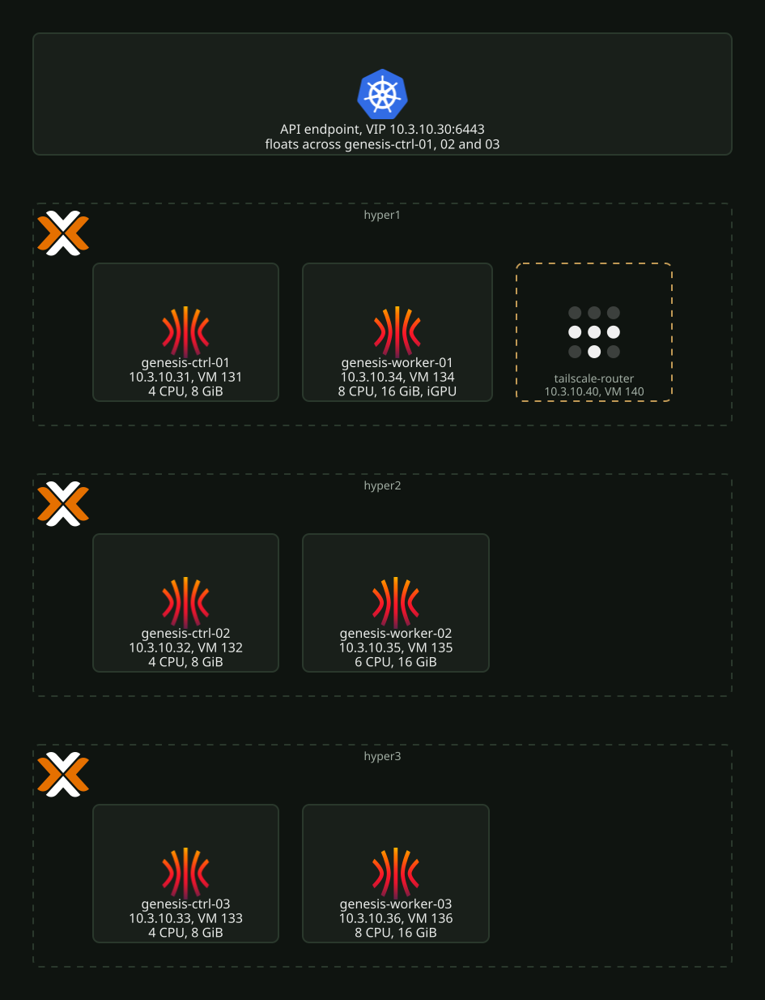

# Talos cluster

The Kubernetes cluster "genesis" runs on six Talos VMs, two per Proxmox node.
`terraform/proxmox/hyper-cluster/k8s/talos` defines all of them. Terraform creates the VMs,
applies the machine config, bootstraps etcd, installs Cilium and Argo CD, and applies the root
Argo CD applications. From there Argo CD owns everything in the cluster.

[](../../assets/diagrams/cluster-layout.svg)

| Node | Host | IP | VMID | CPU | Memory |
|---|---|---|---|---|---|
| `genesis-ctrl-01` | hyper1 | 10.3.10.31 | 131 | 4 | 8 GiB |
| `genesis-ctrl-02` | hyper2 | 10.3.10.32 | 132 | 4 | 8 GiB |
| `genesis-ctrl-03` | hyper3 | 10.3.10.33 | 133 | 4 | 8 GiB |
| `genesis-worker-01` | hyper1 | 10.3.10.34 | 134 | 8 | 16 GiB |
| `genesis-worker-02` | hyper2 | 10.3.10.35 | 135 | 6 | 16 GiB |
| `genesis-worker-03` | hyper3 | 10.3.10.36 | 136 | 8 | 16 GiB |

Every node has a 50 GB disk on its host's `local-lvm`. The API endpoint is the VIP
`10.3.10.30`. `genesis-worker-01` also holds the hyper1 iGPU
([`gpu-passthrough.md`](gpu-passthrough.md)). The live values are in the gitignored
`terraform.tfvars`. `terraform.tfvars.example` shows the shape.

## Access

Apply writes `talosconfig` and `kubeconfig` into the Terraform folder (both gitignored).
`terraform output -raw talosconfig` and `terraform output -raw kubeconfig` print them again.

The Argo CD admin password, for a fresh install:

```bash
kubectl -n argocd get secret argocd-initial-admin-secret -o jsonpath='{.data.password}' | base64 -d
```

`kubeconfig` is a `local_sensitive_file`. Any edit to it on disk (for example a default
namespace) shows as drift, and the next apply rewrites the file. Set the namespace again
after the apply, or keep a copy elsewhere.

## Node operations

All of these are edits to the `nodes` map in `terraform.tfvars`, followed by `terraform apply`.

### Add a node

Add an entry with a free IP, MAC and VMID and `node_type` `worker` or `controlplane`. Apply
creates the VM and applies the machine config. The node joins on its own.

### Remove a node

```bash
kubectl drain <node> --ignore-daemonsets --delete-emptydir-data
kubectl delete node <node>
```

Then delete its entry and apply. For a control plane node, check etcd membership with
`talosctl etcd members` first. The cluster needs a majority of the remaining members.

### Move a node to another host

Change `proxmox_node`. The VM resource has `migrate = true`, so Proxmox migrates the VM and
Terraform does not recreate it. The disk is on `local-lvm`, so the migration copies it
across. `genesis-worker-01` cannot move while it has `pci_mapping` set, because the mapping
exists only on hyper1. Keep one control plane node per host, so a host reboot never takes
etcd below quorum.

### Resize the disk

Raise `disk_size_gb`. The provider refuses a smaller value. Talos uses the extra space.

### Change CPU or memory

Change `cpu_cores` or `memory_mb`. The provider reboots the VM itself when a change needs it
(`reboot_after_update` defaults to true). Drain the node before the apply and uncordon it
after:

```bash
kubectl drain <node> --ignore-daemonsets --delete-emptydir-data
terraform apply
kubectl uncordon <node>
```

The passthrough pins the memory of `genesis-worker-01`. It counts against hyper1's RAM in
full ([`gpu-passthrough.md`](gpu-passthrough.md)).

## Certificates

The client certificates in `talosconfig` and `kubeconfig` are valid for a year. Server
certificates rotate on node reboot and upgrade. Terraform reissues the kubeconfig client
certificate on an apply within 90 days of expiry (`certificate_renewal_duration`).

Check expiry:

```bash
grep "crt:" ./talosconfig | head -1 | awk '{print $2}' | base64 -d | openssl x509 -noout -enddate
grep "client-certificate-data:" ./kubeconfig | awk '{print $2}' | base64 -d | openssl x509 -noout -enddate
```

Renew before expiry:

```bash
talosctl --talosconfig=./talosconfig -n 10.3.10.30 config new talosconfig-new --roles os:admin --crt-ttl 8760h
talosctl --talosconfig=./talosconfig --endpoints 10.3.10.30 kubeconfig ./kubeconfig --nodes 10.3.10.30 --force
```

After expiry, rebuild the configs from the machine secrets in Terraform state. Run from the
Terraform folder:

```bash
./convert-secrets.sh > machine-secrets.yaml
talosctl gen config --with-secrets machine-secrets.yaml hyper-cluster https://10.3.10.30:6443 --force
export TALOSCONFIG=./talosconfig
talosctl --endpoints 10.3.10.30 --nodes 10.3.10.30 health
talosctl --endpoints 10.3.10.30 kubeconfig ./kubeconfig --nodes 10.3.10.30 --force
rm -f machine-secrets.yaml controlplane.yaml worker.yaml
```

The secrets bundle holds the cluster CA keys. Never leave `machine-secrets.yaml` on disk.

If the Terraform state is unavailable, the same bundle is in Bitwarden Secrets Manager as
`talos-genesis-machine-secrets`. Write its value to `machine-secrets.yaml` instead of running
`convert-secrets.sh`. The bundle stops working after `talosctl rotate-ca`, so replace it after a rotation.
A `talosconfig` made this way outside the Terraform folder survives the next apply. The apply
rewrites only the one inside the folder, from state.

## Upgrades

[`talos-upgrade.md`](talos-upgrade.md).
