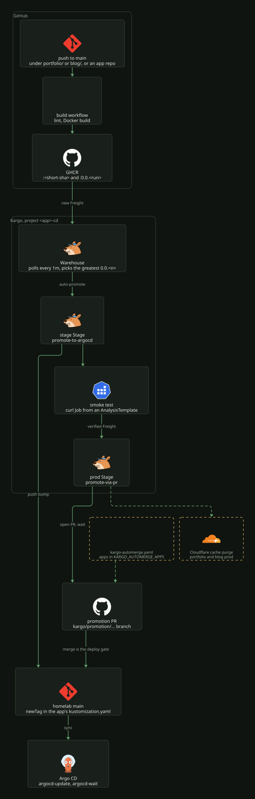

# Kargo app promotion

Kargo promotes container images into the cluster on top of Argo CD. CI only builds
and pushes the image. Kargo notices the new tag, rewrites `newTag` in the app's
kustomization, commits it to this repo and syncs the Argo CD Application. Every
app that ships its own image runs through it.

## Pipelines

Each app has a Warehouse that watches one GHCR repo and auto-promotes new Freight
into its first Stage. A second Stage only receives Freight that passed the smoke
test of the first one.

| App | Image | Stages | Smoke test |
| --- | --- | --- | --- |
| portfolio | `ghcr.io/mortennordbye/homelab/portfolio` | stage, prod | `https://portfolio-stage.local.bigd.no/`, then `https://nordbye.it/` |
| blog | `ghcr.io/mortennordbye/homelab/blog` | stage, prod | `https://blog-stage.local.bigd.no`, then `https://blog.nordbye.it` |
| headroom | `ghcr.io/mortennordbye/headroom` | demo, prod | `https://headroom.nordbye.it` (demo), `https://headroom.local.bigd.no/` (prod) |
| logeverylift | `ghcr.io/mortennordbye/logeverylift` | prod | `https://logeverylift.com/` |
| verksted | `ghcr.io/mortennordbye/verksted` | prod | `https://verksted.local.bigd.no/` |
| reelsmith | `ghcr.io/mortennordbye/reelsmith-gateway` | prod | `https://gate.nordbye.it/healthz` |
| innestemme | `ghcr.io/mortennordbye/innestemme` | prod | `http://innestemme.innestemme.svc.cluster.local:9090/healthz` |

Every `stage` and `demo` Stage uses `promote-to-argocd`. Every `prod` Stage uses
`promote-via-pr`, except innestemme's, which uses `promote-to-argocd` too. innestemme
is a voice assistant in one living room. Its own CI is the gate, and every build is
deployed. The smoke tests are AnalysisTemplates in each `<app>.yaml` that run a curl
Job. The ones on `*.local.bigd.no` and on `nordbye.it`, `blog.nordbye.it` and
`logeverylift.com` pass `-k`. The headroom demo and reelsmith ones verify TLS.
innestemme's is plain HTTP on its in-cluster Service.
portfolio and blog prod also purge the Cloudflare cache for `nordbye.it` after
the sync. They use the `cloudflare-api-token` ExternalSecret in their Project.

## Promotion tasks

Both live in `k8s/talos/infra/kargo-projects/` as ClusterPromotionTasks. Stages
only supply the vars `appName`, `appPath`, `imageRepo` and `argocdApp`.

`promote-to-argocd` (`clusterpromotiontask.yaml`) runs git-clone,
kustomize-set-image, git-commit, git-push to `main`, argocd-update, argocd-wait.

`promote-via-pr` (`clusterpromotiontask-pr.yaml`) pushes the bump to a generated
`kargo/promotion/...` branch and opens a homelab PR. It blocks in git-wait-for-pr until
the PR is merged. Then it runs argocd-update and argocd-wait. The merge of the PR is
the deploy gate.

Before it opens the PR, an `http` step queries Prometheus with the Stage's optional
`budgetQuery` var. The query returns the lowest error budget the app has left. The PR
gets `slo/budget-ok`, or `slo/budget-low` when the budget is below 25 %, when there is
no data, or when Prometheus is unreachable. `kargo-automerge.yaml` does not merge a
`slo/budget-low` PR. Stages without the var (apps with no SLO) get `slo/none`.
Portfolio, blog and logeverylift prod set it. The policy is in
[slos.md](../observability/slos.md#error-budget-policy).

argocd-wait blocks until the Application is Synced and Healthy. argocd-update does not
pin `desiredRevision`. Apps track the shared `main` HEAD, and a pinned revision reports
the Stage Unhealthy as soon as any other commit is pushed. The smoke test is the real
verification.

## Facts

| Item | Value |
| --- | --- |
| Project and namespace | `<app>-cd`, separate from the app namespace |
| Image tags | CI pushes a strict SemVer `0.0.<n>` tag per build; the Warehouse (`SemVer`, `strictSemvers`) picks the greatest |
| Git write | GitHub App `mortennordbye-homelab-deployer`, credential per Project via ESO |
| Sync permission | `kargo.akuity.io/authorized-stage` on the Argo CD app, stamped by `k8s/talos/infra/argocd/apps.yaml` |
| Discovery latency | about 1 minute: Warehouses poll at `interval: 1m0s` |
| PR labels | `kargo`, `app/<name>`, `env/<stage>`, `slo/budget-ok`, `slo/budget-low` or `slo/none`, set by git-open-pr |
| UI | `https://kargo.local.bigd.no`, Authentik SSO (group `kargo-admins`), admin account kept as break-glass |
| Versions | Kargo chart in `k8s/talos/infra/kargo/kustomization.yaml`, Argo Rollouts in `k8s/talos/infra/argo-rollouts/kustomization.yaml` |

## Files

| Path | Purpose |
| --- | --- |
| `k8s/talos/infra/kargo/` | Kargo install (Helm OCI chart), values, UI route |
| `k8s/talos/infra/argo-rollouts/` | AnalysisTemplate and AnalysisRun CRDs used for verification |
| `k8s/talos/infra/kargo-projects/clusterpromotiontask.yaml` | `promote-to-argocd` |
| `k8s/talos/infra/kargo-projects/clusterpromotiontask-pr.yaml` | `promote-via-pr` |
| `k8s/talos/infra/kargo-projects/<app>.yaml` | One multi-document file per app: Namespace, Project, ProjectConfig, git credential, Warehouse, AnalysisTemplates, Stages |
| `k8s/talos/infra/argocd/apps.yaml` | `authorized-stage` annotations via `templatePatch` |
| `.github/workflows/kargo-automerge.yaml` | Squash-merges promotion PRs for apps in `KARGO_AUTOMERGE_APPS` |

## Operate

A deploy to prod is automatic up to the gate. The gate is the PR that Kargo opens
(`chore(<app>): promote <tag> to prod`). Merge it. Nothing reaches prod without that
merge.

Apps listed in the `KARGO_AUTOMERGE_APPS` repository variable skip the manual merge.
`kargo-automerge.yaml` squash-merges their promotion PR when it carries the
`app/<name>` label and does not carry `slo/budget-low`. Check the current list with
`gh variable get KARGO_AUTOMERGE_APPS`. An edit of the variable (Settings, Secrets and
variables, Actions) is the kill switch, per app or for all of them, with no commit.
Kargo still opens the PR and waits on it. When you remove an app, a human is back in
front of the merge.

A push under the app's path (in-repo apps) or to the app repo's `main` (external apps)
triggers a build. Inspect a pipeline with
`kubectl -n <app>-cd get warehouse,stage,freight,promotion`.

## Onboard an app

In-repo app with stage and prod, like portfolio or blog:

1. Add an `images:` block to the prod and stage kustomizations with
   `name: ghcr.io/mortennordbye/homelab/<app>` and `newTag` set to the tag running now.
2. The build workflow runs with `contents: read` and pushes a
   `0.0.${{ github.run_number }}` tag. It never writes manifests.
3. Copy `portfolio.yaml` to `kargo-projects/<app>.yaml` and register it in
   `kargo-projects/kustomization.yaml`.
4. Add `<app>` to the list in the `apps.yaml` `templatePatch`.

External-repo app with a single prod Stage, like logeverylift:

1. Put the deploy manifests under `k8s/talos/apps/<app>/` with an `images:` block
   (`name: ghcr.io/mortennordbye/<app>`, `newTag` set to the current tag).
2. Copy `logeverylift.yaml` to `kargo-projects/<app>.yaml`: one Warehouse, one
   auto-promoted `prod` Stage on `promote-via-pr`, one smoke AnalysisTemplate on the
   app's URL. Register it in `kargo-projects/kustomization.yaml` and add `<app>` to
   the `apps.yaml` list.
3. In the build workflow of the app repo, push
   `type=raw,value=0.0.${{ github.run_number }},enable={{is_default_branch}}`.

The Warehouse has no Freight until the first `0.0.<n>` build, so the merge order does
not matter. For the git credential, copy the ExternalSecret from an existing Project:
the same Bitwarden keys and the same `conversionStrategy`, `decodingStrategy` and
`metadataPolicy` fields. Only the `namespace` changes, to `<app>-cd`.

## Gotchas

Inside a ClusterPromotionTask, one step references the output of another step as
`task.outputs['<alias>']`, not `outputs.<alias>`. Kargo inflates task steps with a
prefix at Promotion time, so plain `outputs.*` resolves to nil. git-open-pr then gets
an empty branch. The bump is left on an orphan branch, and the promotion reports
Succeeded.

The no-op guard keys on the status of the commit step, not on a branch or an output.
Kargo skips git-commit when there is nothing to commit. push, open-pr and wait-pr
carry `if: ${{ status('commit') != 'Skipped' }}`. argocd-update and argocd-wait stay
unguarded, so a no-op re-promotion still ends green.

A Warehouse polls at the greater of its `spec.interval` and the controller's
`minReconciliationInterval`. `k8s/talos/infra/kargo/values.yaml` sets the latter to
`1m0s`. To set a Warehouse below that, change both.

Commit authorship is set on git-clone. When it is not set, Kargo authors as
`Kargo <no-reply@kargo.io>` and GitHub adds a `Co-authored-by:` trailer to the squash
commit. The `author` field of git-commit is deprecated.

The GitHub App needs Pull requests read/write as well as Contents read/write, or
git-open-pr fails. The credential takes the Installation ID, not the App ID. A wrong
value makes git-push fail with a 404 on the installation token call.

The `<app>-stage` overlay directory deploys to namespace `stage-<app>`. Every stage
manifest declares that namespace explicitly, and that wins over the ApplicationSet.

ESO remoteRefs and Warehouses must spell out defaulted fields
(`conversionStrategy`, `decodingStrategy`, `metadataPolicy`; `strictSemvers`,
`interval`, `discoveryLimit`). If they do not, Argo CD reports them OutOfSync forever.

Per-app annotations in the `apps` ApplicationSet go in `templatePatch`. An inline
`{{if}}` in the parsed `template` is invalid YAML. Check the output offline with
`argocd appset generate --core -n argocd <file>` after you swap the git generator for
a `list` generator.
