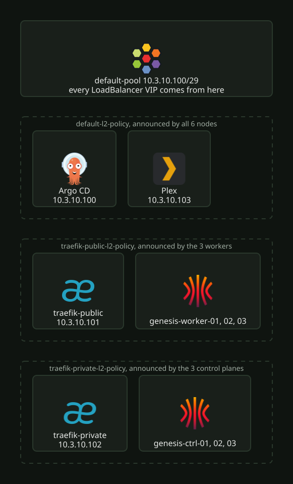
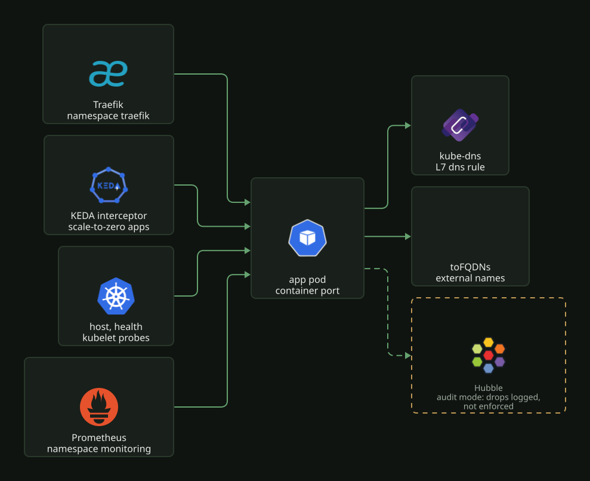

# Cilium

Cilium is the CNI. It replaces kube-proxy, announces the LoadBalancer VIPs on L2 and applies
the CiliumNetworkPolicies. It runs in `kube-system` from the Helm chart
in [`kustomization.yaml`](../../../k8s/talos/infra/cilium/kustomization.yaml) with
[`values.yaml`](../../../k8s/talos/infra/cilium/values.yaml). Cilium's own Gateway API
support is off. Traefik handles ingress ([`traefik.md`](traefik.md)).

## Bootstrap

Talos boots with `cni: none` and `proxy.disabled`, so no node becomes Ready until Cilium
runs. Terraform installs the first release from the same `values.yaml`. It then applies the
IP pool and the L2 policies with kubectl
([`k8s-cilium.tf`](../../../terraform/proxmox/hyper-cluster/k8s/talos/k8s-cilium.tf)).
Terraform ignores later changes to the version and the values. Argo CD owns the release from
then on. See [`../cluster/talos.md`](../cluster/talos.md).

Settings that tie Cilium to Talos:

- `k8sServiceHost: localhost`, `k8sServicePort: 7445`: the API through KubePrism.
- `ipam.mode: kubernetes`: Talos assigns the node pod CIDRs.
- `ipv4NativeRoutingCIDR: 10.244.0.0/16` must equal the cluster pod subnet. That is the
  Talos default, and `talos-cluster.tf` does not override it. The DSR load balancer mode
  (`loadBalancer.mode: dsr`, `algorithm: maglev`) needs native routing.
- `bpf.hostLegacyRouting: true`: Talos forwards kube-dns to the host DNS. That forwarding
  breaks without this setting.
- `cgroup.autoMount.enabled: false` with `hostRoot: /sys/fs/cgroup`: Cilium reuses the Talos
  mount.
- The agent's capability list leaves out `SYS_MODULE`. Talos does not let workloads load
  kernel modules.
- The operator tolerates every taint (`operator.tolerations: [{operator: Exists}]`). Nodes
  stay NotReady until Cilium runs, so the operator must schedule on NotReady nodes during
  bootstrap. It runs two replicas with a PDB.

## L2 announcements and LB IPAM

`CiliumLoadBalancerIPPool` `default-pool` assigns addresses from `10.3.10.100/29`
([`loadbalancer-ippool.yaml`](../../../k8s/talos/infra/cilium/loadbalancer-ippool.yaml)).
[`README.md`](README.md) lists the assigned VIPs. A Service pins its address with the
`lbipam.cilium.io/ips` annotation.

Three `CiliumL2AnnouncementPolicy` objects
([`l2-announcement-policy.yaml`](../../../k8s/talos/infra/cilium/l2-announcement-policy.yaml))
decide which nodes answer ARP for a VIP:

| Policy | Services | Nodes |
| --- | --- | --- |
| `traefik-public-l2-policy` | label `network.nordbye.it/vip: public` | workers |
| `traefik-private-l2-policy` | label `network.nordbye.it/vip: private` | control planes |
| `default-l2-policy` | every Service without the label | all |

[](../../assets/diagrams/network-cilium-l2.svg)

The Traefik VIPs get disjoint node sets, so one bad node cannot stop both gateways. The
default policy covers a new LoadBalancer Service with no label.

After a change that rolls the agent DaemonSet, check the BPF LB map on each node. See
[`../observability/incidents.md`](../observability/incidents.md).

## Hubble

Hubble, the relay and the UI are on. The UI is at `hubble.local.bigd.no` on the private
gateway ([`httproute-hubble.yaml`](../../../k8s/talos/infra/cilium/httproute-hubble.yaml)).
Hubble metrics go to Prometheus on port 9965, and they include policy verdicts per workload
and namespace. The agent, operator and Envoy metrics are on 9962, 9963 and 9964.

certgen issues Hubble's TLS certificates in the cluster (`hubble.tls.auto.method:
cronJob`). Helm does not issue them: Helm would mint a new CA on every render and rotate it
under the agents on each Argo CD sync. Leaves are valid for 365 days
(`certValidityDuration`). The cron schedule `0 0 1 */4 *` reissues them. The leaf lifetime
must end before the CA's (`tls.ca`, three years), or certgen refuses to issue.

## Network policies

Every app namespace except `home-assistant`, and most infra namespaces, has a
`ciliumnetworkpolicy.yaml`. List them with `kubectl get ciliumnetworkpolicy -A`.
Cilium enforces the policies (`policyAuditMode: false`). Drops show as `DROPPED` verdicts in
Hubble and in `hubble_policy_verdicts_total{action="dropped"}`. `policyAuditMode` is a single
agent-wide setting with no per-namespace toggle. If you turn it back on, it relaxes every
policy at once.

[Rolling out Cilium network policies](https://blog.nordbye.it/blog/cilium-network-policy-rollout/)
describes how the policies went from audit mode to enforced, with the Hubble workflow.

Right after a node reboots, Cilium can drop a pod's first connection to a `toFQDNs` name,
before Cilium has seen the DNS answer. The retry passes. An app that does not retry needs a
restart.

Cilium denies a direction by default only when a policy has a rule for that direction. An
ingress-only policy leaves egress open.

[](../../assets/diagrams/network-cilium-policy.svg)

A new app's policy, copied from the one closest to it:

- Ingress from Traefik on the container port. Every app uses the same selector:

  ```yaml
  - fromEndpoints:
      - matchLabels:
          "k8s:io.kubernetes.pod.namespace": traefik
          "k8s:app.kubernetes.io/instance": traefik-traefik
    toPorts:
      - ports:
          - port: "8080"
            protocol: TCP
  ```

- Ingress from the KEDA interceptor too, if the app scales to zero. Always
  `fromEntities: [host, health]` for probes.
  [`omni-tools/ciliumnetworkpolicy.yaml`](../../../k8s/talos/apps/omni-tools/ciliumnetworkpolicy.yaml)
  has all three.
- No egress rules if the app needs broad outbound access, as in
  [`verksted/ciliumnetworkpolicy.yaml`](../../../k8s/talos/apps/verksted/ciliumnetworkpolicy.yaml).
- For restricted egress, allow DNS to `kube-dns` with an L7 `dns` rule. Then add
  `toFQDNs` for the external names.
  [`external-dns/ciliumnetworkpolicy.yaml`](../../../k8s/talos/infra/external-dns/ciliumnetworkpolicy.yaml)
  is the template. Without the `rules.dns` block, Cilium never learns the addresses behind a
  name, and the `toFQDNs` rule matches nothing.
- Prometheus scrapes come from pods labelled `app.kubernetes.io/name: prometheus` in
  `monitoring`.

To check a new policy, look for dropped flows that involve the app. Use Hubble
(`hubble observe --verdict DROPPED` in a Cilium agent pod) or this query in Prometheus:

```promql
sum by (source, destination, direction) (increase(hubble_policy_verdicts_total{action="dropped", destination_namespace="<ns>"}[1h]))
```

In that metric, `destination` is the pod the policy applies to, and `source` is the peer, in
both directions.
