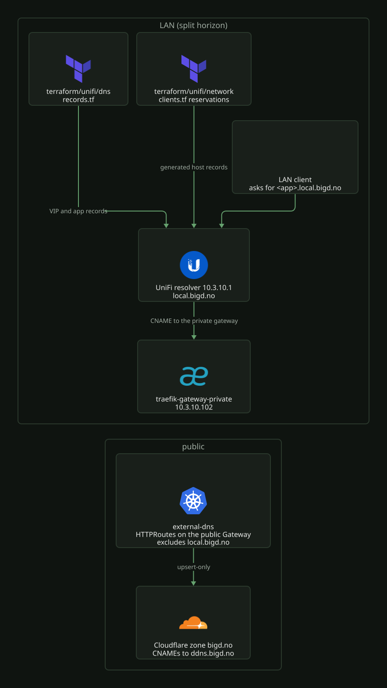

# Internal DNS: local.bigd.no

`local.bigd.no` is the LAN-only half of a split horizon. The resolver on the UniFi
gateway (`10.3.10.1`) serves it. The console shows it under Settings > Policy
Table > DNS Records. The public half is the `bigd.no` zone in Cloudflare, see
[`cloudflare.md`](cloudflare.md).

[](../../assets/diagrams/network-dns.svg)

## Who writes what

| Records | Written by |
| --- | --- |
| Gateway VIPs and app aliases (user-defined) | `terraform/unifi/dns/records.tf` |
| Host names for fixed-IP clients (console "Default Policies") | generated from the DHCP reservations in `terraform/unifi/network/clients.tf` |
| Public `*.bigd.no` app hostnames | external-dns, in Cloudflare |

external-dns must never write this zone. `k8s/talos/infra/external-dns/values.yaml`
lists `local.bigd.no` under `excludeDomains`. An internal hostname can therefore not
leak into the public zone, even when a route passes the gateway filter. Do not remove it.

## Records

`records.tf` declares two sets:

- `local.vips`: A records for the Cilium LB-IPAM VIPs, `traefik-gateway-public`
  (`10.3.10.101`), `traefik-gateway-private` (`10.3.10.102`) and `plex`
  (`10.3.10.103`). These are VIPs, not hosts. When one changes in
  `k8s/talos/infra/cilium`, the map must change too.
- `local.aliases`: CNAMEs to `traefik-gateway-private.local.bigd.no`, one per
  HTTPRoute attached to `gateway-private`.

To add an internal app, add its name to `local.aliases`. The list is maintained by
hand. Nothing reconciles it with the HTTPRoutes.

## Generated host records

The console also lists records that it generates from DHCP reservations (`nas`, `pbs`,
`hyper1`-`hyper3`, `home`, `hue-bridge-pro`, the six `genesis-*` nodes). The
`static-dns` API and the newer `dns/policies` API do not return them, so there is
nothing to import. A declaration in `records.tf` would create a second, user-defined
record that shadows the generated one. Rename or renumber those in `clients.tf`
instead.

## AdGuard and the forwarding loop

Clients resolve through AdGuard on Home Assistant (`10.3.10.15`). AdGuard sends
`local.bigd.no` to the gateway with the upstream line `[/local.bigd.no/]10.3.10.1`.
The WAN DNS of the gateway is AdGuard (`terraform/unifi/network/networks.tf`). A query
that the gateway cannot answer from its records therefore goes back to AdGuard, and
AdGuard sends it to the gateway again. The generated host records are A only, so every
AAAA lookup for them loops until it times out. `getaddrinfo` then fails the whole lookup
with `EAI_AGAIN`, although the A record answered. This stops everything that resolves a
Proxmox host by name (pve-exporter, the backup check).

The custom filtering rules in AdGuard break the loop. They answer AAAA for the zone
itself with an empty NOERROR:

```
||local.bigd.no^$dnstype=AAAA,dnsrewrite=NOERROR;;
```

Keep it. IPv6 is disabled on every network and on the WAN, so no host loses an address.
Do not replace the WAN DNS of the gateway with a public resolver. A public resolver
answers NXDOMAIN for the AAAA, and musl treats an NXDOMAIN on either half as "no such
host".

The same rule list also has a permanent allowlist for `tiktokv.com`, `tiktokw.eu`
and `byteoversea.com`. TikTok signs its requests through those hosts. When they are
blocked, the developer portal loads but every write fails without an error.

## Provider notes

- `ttl` is unset everywhere. The console stores "Auto" as 0 and the provider maps
  0 to a null TTL. A set TTL would therefore show as a change against every record.
- `site` and `enabled` are unset too. Both are Optional+Computed and take the
  values of the controller.
- The provider uses the undocumented `v2/api/site/<site>/static-dns`
  endpoint. The official `integration/v1/sites/<id>/dns/policies` API returns
  the same records, but no Terraform provider implements it. A firmware release
  that removes the v2 route breaks this stack. The `filipowm/unifi` fork uses
  the same route, so a change of provider is not the fix.

## Rebuilding state

`name` forces replacement. An apply into a populated controller without state
therefore recreates the live records instead of adopting them. If the state is lost,
list the records and write a temporary `imports.tf`:

```bash
curl -sk -H "X-API-KEY: $KEY" \
  https://10.3.10.1/proxy/network/v2/api/site/default/static-dns
```

Each `_id` becomes `id` in an `import` block that addresses
`unifi_dns_record.vip["<name>"]` or `unifi_dns_record.alias["<name>"]`. Apply
only when the plan reports imports and no adds, changes or destroys. Then delete
the file.
