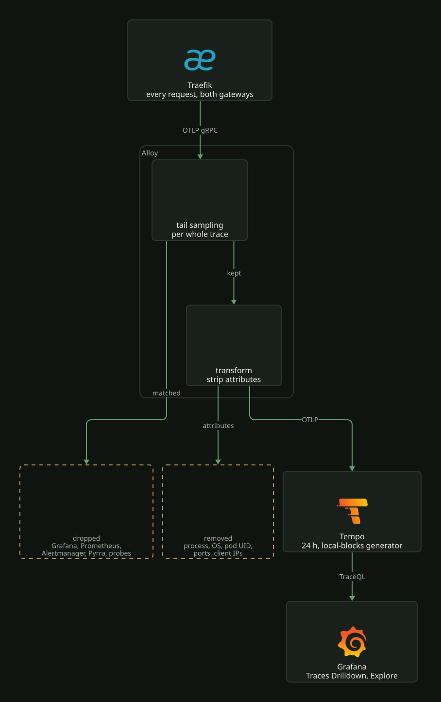
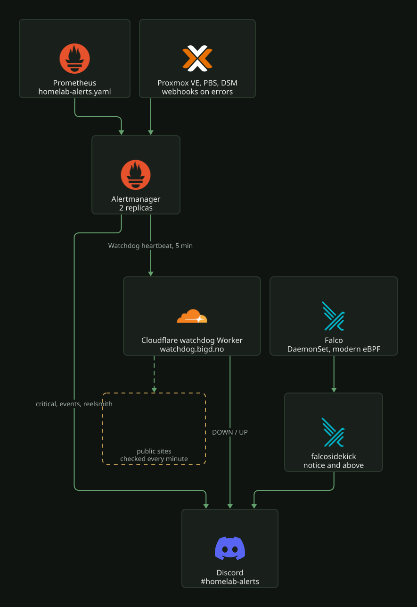

# Monitoring

[sre.md](sre.md) explains how alerts, SLOs, runbooks, incidents and the weekly review fit
together.

## Where to look

| What | URL |
|---|---|
| Grafana, dashboard Homelab-SPOG | https://grafana.local.bigd.no/d/mns9wmn |
| Grafana, dashboard User journeys | https://grafana.local.bigd.no/d/user-journeys |
| Grafana, dashboard logeverylift Traces | https://grafana.local.bigd.no/d/logeverylift-traces |
| Alertmanager, alerts and silences (authentik sign-in, group `alertmanager-admins`) | https://alertmanager.local.bigd.no |
| Prometheus | https://prometheus.local.bigd.no |
| Grafana Drilldown: metrics, logs and traces without a dashboard | https://grafana.local.bigd.no/drilldown |
| Pyrra, SLOs and error budgets | https://pyrra.local.bigd.no |
| OpenCost, estimated cost per namespace ([costs.md](costs.md)) | https://opencost.local.bigd.no |
| Discord | `#homelab-alerts` |

Dashboards show live data. The one exception is the Full architecture row. It is labelled as
not live.

The SPOG rows go from outside in: the network and hosts first, then the cluster platform,
then the apps. Every row starts collapsed, except Alerts. Alerts is at the top.

| Row | Shows |
|---|---|
| Alerts | alerts firing now by severity, and the list with namespace and how long each has fired, linked to Alertmanager; `Watchdog` and `InfoInhibitor` are left out |
| Internet & network | internet up/down, availability, downtime and outages over the range, probe latency; UniFi WAN latency, session uptime, drops, gateway CPU, switch port traffic, errors and drops |
| Public sites | public site probes and response time, traffic share per site, then request rate, 5xx rate, p95 and status codes per site (one repeated set of panels over the hidden `site` variable) |
| SLOs & error budgets | budget left per site for the paging probe SLO and per request SLO, probe burn rate against the 1x and 7x lines, rolling 28-day SLIs against their objectives ([slos.md](slos.md)) |
| Proxmox | host up/down, VMs running and stopped (templates excluded), host CPU, memory and CPU temperature, storage used per host (local, local-lvm) and shared (pbs, nfs-vmstore), NVMe wear, spare, temperature and errors per host |
| NAS (Synology) | system status, Volume 1 used and free, RAID status, unhealthy disks, temperature, eth0 traffic, disk temperatures |
| Backups | age of the last etcd and dump jobs, VolSync sources behind schedule, PBS datastore usage and the newest snapshot per VM |
| Nodes | per-node CPU, load, memory, disk I/O and space, network, Talos `/var` free space |
| Workloads | CPU and memory usage and limits per namespace, PVC inventory, warning event rate by reason |
| Ingress & DNS | Traefik request rate, 5xx rate, latency, top services; CoreDNS requests, response codes, cache hits, latency |
| Cilium | drops by reason, policy import, endpoint regeneration, Hubble policy drops and the dropped flows |
| Certificates | readiness, days to expiry per certificate, sync errors, ACME latency |
| GitOps & secrets | Argo CD sync and health, ESO sync status and secrets not ready, Reloader reloads |
| KEDA autoscaling | replica and scaler state, wake-from-zero, capacity and electricity reclaimed, priced at the NO1 spot price plus VAT plus the `grid_fee_per_kwh` variable |
| Falco | instances, rule matches, event drops, CPU and memory per node |
| Policy (Kyverno) | controllers up, workloads on mutable tags and breaking baseline, restricted and requests compliance, admission rate, image provenance coverage, failures and verification time, the failing workloads ([policy](../policy/README.md)) |
| Cost, estimated (OpenCost) | estimated electricity cost per 30 days and per namespace, idle share, allocated CPU and memory, today's price against the OpenCost rate ([costs](costs.md)) |
| Monitoring stack (storage and intake) | disk used by metrics, logs and traces against their limits, active series, logs received per day, dropped log entries, metrics by scrape job, logs by namespace, memory per component, intake over time ([storage](#monitoring-stack-storage)) |
| Media stack | service status, health issues, queues, free space, library, download client and indexers |
| Full architecture (from .d2, not live) | the whole homelab from `homelab-overview.d2`, loaded from the docs site. A change to that file reaches it by itself: `render-assets` commits the SVG and starts the docs deploy, and browsers may cache the old image for up to 10 minutes. It needs the docs site and the internet to show. |
| Live service map (Hubble) | which namespaces talk to which, drawn from `hubble_policy_verdicts_total`, so new apps appear by themselves. Shows policy decisions per second, not bytes, and leaves out traffic to the internet and the nodes. |

Kubernetes events and live logs are on the separate Homelab-Log-SPOG dashboard. The other
dashboards from this repo: User journeys, GitHub, Cloudflare, Postgres and logeverylift Traces.

The dashboards from this repo are JSON files under [`grafana/`](../../../grafana/README.md).
[Git Sync](#git-sync) loads them into Grafana's Homelab folder. Pyrra's dashboards are in
the SLOs folder. The `k8s-sidecar-target-directory` annotation on the ConfigMaps that the
sidecar loads sets that folder (`k8s/talos/infra/pyrra/values.yaml`). Chart dashboards
without the annotation stay at the top level.

Both dashboards draw a vertical line for every Argo CD sync (the "Deploys" annotation, on by
default). This lets you match a change in a graph to the commit that caused it. Hover the
line to see the app, the short revision and the commit subject. Argo CD notifications
writes these lines as Grafana annotations tagged `argocd`
([`../delivery/argocd.md`](../delivery/argocd.md#deploy-markers)).

## Monitoring stack storage

| Signal | Store | Kept | Volume |
|---|---|---|---|
| Metrics | Prometheus | 30 days or 35 GiB, whichever comes first | 40 GiB on `syno-nfs-csi` |
| Logs | Loki | 7 days | 20 GiB on `proxmox-local` |
| Traces | Tempo | 24 hours | 10 GiB on `proxmox-local` |

`kubelet_volume_stats_*` is correct only for the two local volumes. On an NFS volume it
reports the whole NAS share. The Prometheus, Grafana and Alertmanager volumes therefore all
show the same figure. The SPOG row reads the size of Prometheus from
`prometheus_tsdb_storage_blocks_bytes` and `prometheus_tsdb_wal_storage_size_bytes` instead.
It has no real figure for Grafana or Alertmanager.

When metrics grow, start with Metrics by scrape job. For logs, start with Logs by namespace.

Log entries dropped counts the lines that Loki refused. The usual cause: Alloy read the lines
again from a running pod, and they were past the 24-hour age limit
(`reject_old_samples_max_age`). A small number is expected.

## GitHub

The GitHub dashboard lists merged and open pull requests, and the merges per day, for the
repo selected in its Repository dropdown (default `homelab`). The SPOG also draws a "PR
merged" annotation for every Homelab merge. The gap between a merge and its Argo CD deploy
marker is then visible on the same graph. The PR marker shows the title and the author. The
plugin cannot make it a link, so the PR link is on the deploy marker next to it.

Grafana queries the GitHub API on demand with the `grafana-github-datasource` plugin (data
source uid `github`). Nothing is scraped or stored. The panels reach back only as far as the
time range asks for, and each refresh spends GitHub API quota.

Grafana authenticates as the GitHub App `mortennordbye-homelab-grafana`. The App is
installed on all of the account's repositories with Metadata read, and Contents, Pull
requests and Webhooks read and write. The write is for [Git Sync](#git-sync). The data
source only reads. The App ID, installation ID and private key come from Bitwarden through
the `grafana-github-app` ExternalSecret. They are mounted as files, because the PEM is
multiline. The Grafana network policy allows egress to `api.github.com`.

## Git Sync

Grafana's Git Sync keeps the dashboards under [`grafana/`](../../../grafana/README.md) in this
repo in a Grafana folder named Homelab. Grafana polls `main` every 60 seconds and loads
any change. When you save a dashboard in that folder in the UI, Grafana commits to a new
branch and shows a link to open the pull request. Grafana does not open the pull request
itself. Nothing writes to `main` directly: the repository's `workflows` is `branch` only.
Git Sync registers a repository webhook on create, and it refuses to start without the
Webhooks permission. GitHub cannot reach `grafana.local.bigd.no`, so polling is the only
trigger that works.

The `grafana-git-sync` Job (`k8s/talos/infra/kube-prometheus-stack/git-sync.yaml`) is an Argo
CD PostSync hook. It POSTs two resources to Grafana's `provisioning.grafana.app/v1beta1` API
as the local admin. When they already exist, it merge-patches them:

| Resource | Name | What it holds |
|---|---|---|
| Connection | `homelab-github` | the GitHub App's ID, installation ID and private key, from the `grafana-github-app` secret |
| Repository | `homelab` | repo URL, branch `main`, path `grafana/`, folder target, branch workflow |

To change either resource, edit the Job and sync. The next sync overwrites an edit made in
Administration > Provisioning. Argo CD does not count a hook as drift. A commit that only
changes the Job therefore needs a manual sync before it runs. The Job reaches Grafana on
port 3000 through an ingress rule in the Grafana network policy. Grafana needs egress to
both `api.github.com` (App tokens, webhook, PRs) and `github.com` (the git clone and fetch).

A Repository caches its installation token for an hour. After you change the App's
permissions, delete the Repository in Administration > Provisioning and sync the app. This
recreates it with a fresh token.

The chart's and Pyrra's dashboards still come from ConfigMaps through the sidecar. They
cannot be saved back to git. A dashboard `uid` must exist in only one of the two sources.
Git Sync does not take over a dashboard that the sidecar already provisions.

## Cloudflare

The Cloudflare dashboard shows edge traffic for the zone selected in its Zone dropdown:
requests, bandwidth and visits, cache status, status codes, origin response time for uncached
requests, top hosts, paths, countries, content types, edge locations and HTTP protocol. Below
that are the Web Analytics for every site with the beacon (visits, page views, Core Web
Vitals at p75, page load time, top pages, referrers, countries, browsers, devices), the
zone's DNS queries, the watchdog Worker, and Email Routing.

Grafana queries Cloudflare's GraphQL analytics API live through the Infinity plugin (data
source uid `cloudflare`). Nothing is stored, so the history ends where Cloudflare's history
ends: 31 days for traffic and DNS, 184 days for Web Analytics. The zones are on the Free
plan. That plan leaves out some fields: edge time to first byte, referrer host and ASN on
HTTP requests, and firewall events. A query that names one of them fails with "does not have
access to the field". Referrers come from Web Analytics instead.

The data source reads a read-only user token, `homelab-grafana-read`, from the
`grafana-cloudflare` ExternalSecret. The token is mounted as a file. The Grafana network
policy allows egress to `api.cloudflare.com`.

## Stack

Grafana reads Prometheus, Loki and Tempo as data sources. It reads GitHub and Cloudflare
directly ([GitHub](#github), [Cloudflare](#cloudflare)). The blog post
[The observability stack I actually run](https://blog.nordbye.it/blog/observability-stack/)
describes the stack and the SPOG dashboard.

| Component | Role | Retention | Defined in |
|---|---|---|---|
| Prometheus | metrics, alert rules | 30 days, at most 35 GB | `k8s/talos/infra/kube-prometheus-stack/values.yaml` |
| Alertmanager | routing to Discord, 2 replicas | 5 days of silences and notification state | `k8s/talos/infra/kube-prometheus-stack/values.yaml` |
| Loki | logs, single binary | 7 days, Kubernetes events 30 days | `k8s/talos/infra/loki/values.yaml` |
| Alloy | DaemonSet shipping pod logs (each pod reads its own node's pods) and Kubernetes events (one clustered pod collects them) to Loki, and filtering traces on the way to Tempo (monitoring UIs and blackbox probes dropped, per-connection and client-IP attributes and URL query strings removed) | none | `k8s/talos/infra/loki/alloy-values.yaml` |
| Tempo | traces, pushed over OTLP by Traefik and logeverylift through Alloy; its local-blocks generator answers TraceQL metrics for Traces Drilldown | 24 h | `k8s/talos/infra/tempo/values.yaml` |
| Pyrra | SLOs to recording rules and burn-rate alerts, SLO UI ([slos.md](slos.md)) | none | `k8s/talos/infra/pyrra/` |
| OpenCost | cost allocation from Prometheus usage, cost UI ([costs.md](costs.md)) | none | `k8s/talos/infra/opencost/` |
| Falco | runtime security events, modern eBPF driver | none | `k8s/talos/infra/falco/values.yaml` |

Traces take one extra hop. Traefik exports to Alloy. Alloy decides per whole trace what to
keep, and strips noisy attributes, before Tempo stores the trace
([`../network/traefik.md`](../network/traefik.md#tracing-and-metrics)).

logeverylift continues Traefik's trace from the `traceparent` header. Its `@vercel/otel`
setup (`src/instrumentation.ts` in the app repo) adds spans for each Next.js route and
render, each outgoing `fetch`, and every Postgres query. It pushes them over OTLP/HTTP to
`alloy.monitoring:4318` (set by `OTEL_EXPORTER_OTLP_ENDPOINT` in
`k8s/talos/apps/logeverylift/app.yaml`). Query text keeps its `$n` placeholders, never the
values. The logeverylift Traces dashboard charts the spans with TraceQL metrics: request
rate, latency and failures by route, Postgres queries by statement and the connection pool
wait, outgoing calls by host, and tables of the slowest and failed requests. The tables open
the full waterfall. Tempo's generator keeps client spans as well as server spans
(`filter_server_spans: false` in `k8s/talos/infra/tempo/values.yaml`). Without that setting,
the Postgres and outgoing-call panels stay empty. For anything else, use Explore on Tempo
with `{ resource.service.name = "logeverylift" }`.

For the same trace, an app's spans can reach a different Alloy pod than Traefik's spans. A
tail-sampling drop that matches on Traefik's attributes therefore never removes the app's
spans. For this reason, the blackbox probe of logeverylift.com leaves a small app-only trace
every minute. The monitoring-UI drop is not affected, because no instrumented app serves
those hosts. Traces whose `http.route` is `/api/health` are dropped. The kubelet's readiness
and liveness probes call that route directly on the pod, several times a minute, and bypass
Traefik.

## Alert path

Prometheus rules → Alertmanager → Discord. Routing (`k8s/talos/infra/kube-prometheus-stack/values.yaml`):

- `alertname=Watchdog` (always firing) → `heartbeat`: a POST to the Cloudflare watchdog
  Worker every 5 min.
- `severity=critical` → `discord`, with resolved messages.
- namespace `proxmox` or `synology` → `discord-event`: one-shot pushes from Proxmox, PBS and
  DSM, no resolved message. These alerts expire. They do not resolve.
- namespace `reelsmith` → `discord` at every severity.
- everything else is dropped.

Falco does not go through Alertmanager. falcosidekick posts to Discord directly at priority
`notice` and above.

During an internet outage, Discord is not reachable. Alertmanager retries, and delivers when
the line is back.

The watchdog Worker (`terraform/cloudflare/watchdog`, served at `watchdog.bigd.no`) runs
on Cloudflare and posts to the same Discord channel directly, as `[WATCHDOG] DOWN` and
`[WATCHDOG] UP`:

- no heartbeat for 15 min: the cluster, Prometheus, Alertmanager or the home line is down;
- a public site fails three one-minute checks in a row, as seen from the internet.

To test the heartbeat path without silencing other alerts, add an Alertmanager silence
on `alertname=Watchdog` for 25 minutes (`amtool silence add alertname=Watchdog
--duration=25m` in the alertmanager container). The Worker posts DOWN about 15 minutes
after the last heartbeat, and UP within minutes after the silence expires. The Worker's
state is in its KV namespace, keys `heartbeat` and `state:heartbeat`.

Operating notes for the Worker (heartbeat URL rotation, the site list) are in
[`../network/cloudflare.md`](../network/cloudflare.md#watchdog-worker).

## User journeys

The probes above prove that a page answers. A user journey proves that a person can still
use it. k6's browser module drives Chromium through the same steps as the app's own e2e
suite. A broken sign-in, a page that no longer renders, or a write that stops saving then
fails the journey while every probe stays green.

The logeverylift journey runs every 10 minutes from `k8s/talos/infra/synthetics/` as the
user `synthetic@nordbye.it`. It goes through public DNS and Cloudflare, like a visitor. Each
step is a k6 check, written to Prometheus as `k6_checks_rate{journey, check}` (1 pass, 0
fail). The run time and the Core Web Vitals per page (`k6_browser_web_vital_*`) are written
next to it. The dashboard User journeys shows the last result per step and the history.

| Step | Proves |
|---|---|
| `login` | the sign-in form submits and lands on `/` |
| `dashboard` | the home page renders its heading |
| `open-workout` | the program list and a workout page load |
| `open-exercise` | an exercise opens from the workout |
| `log-set` | tapping a set saves it and starts the rest timer |
| `unlog-set` | tapping again saves the undo, so the run leaves no data |

The synthetic user needs an active program whose first exercise has sets (program "Synthetic
check", imported from the Programs screen). It also needs the onboarding tutorial dismissed,
or the tutorial covers every page. The user lives in prod data. If you rename or delete its
program, the journey fails at `open-workout`.

logeverylift allows 10 sign-ins per 15 minutes per client IP. The journey reaches it from
the home line through Cloudflare, so it shares that budget with everyone at home. A run uses
one sign-in. If you run it by hand in a loop, it locks the household out for 15 minutes. A
failed run that stopped between the two taps leaves the set logged. The next run un-logs it
first.

To add a journey, add a script under `scripts/` and a CronJob that runs it, and keep the
`journey` tag unique. The alert rules cover every journey by label.

`kube-prometheus-stack/tests/user-journey-failing.yaml` runs the journey with a wrong
password under its own tag. It fires `UserJourneyFailing` in about 20 minutes, end to end.

## Sources

| Source | Scrapes | Auth | Defined in |
|---|---|---|---|
| kube-prometheus-stack | cluster, nodes, kube-state-metrics | none | `k8s/talos/infra/kube-prometheus-stack/` |
| kube-prometheus-stack, `kubeEtcd` | etcd on the three control planes, `http://10.3.10.31-33:2381/metrics` | none; Talos serves only `/metrics` and `/health` there, set by `listen-metrics-urls` in the control-plane patch | `k8s/talos/infra/kube-prometheus-stack/values.yaml`, `terraform/proxmox/hyper-cluster/k8s/talos/talos-cluster.tf` |
| blackbox-exporter, Probe `internet` | HTTPS to google.com/generate_204 and cloudflare.com/cdn-cgi/trace every 15 s | none | `k8s/talos/infra/blackbox-exporter/` |
| blackbox-exporter, Probe `internal-sites` | every `local.bigd.no` host except the KEDA scale-to-zero ones, through the gateway's DNS and the private gateway, every 60 s | none | `k8s/talos/infra/blackbox-exporter/probe.yaml` |
| blackbox-exporter, Probe `public-sites` | nordbye.it, blog.nordbye.it, logeverylift.com, auth.bigd.no, hub.bigd.no through public DNS and Cloudflare, every 60 s | none | `k8s/talos/infra/blackbox-exporter/probe.yaml` |
| unpoller | UniFi gateway `https://10.3.10.1`, scraped every 30 s; the gateway's system log pushed to Loki every minute as `{application="unifi_system_log"}` | local UniFi user `unpoller`, Network View Only, other apps None, Bitwarden `unpoller-unifi-password` | `k8s/talos/infra/unpoller/` |
| snmp-exporter | NAS `10.3.10.10`, modules `if_mib` + `synology`, every 60 s | SNMPv3 `snmp-exporter`, SHA/AES, Bitwarden `synology-snmp-auth-password`, `synology-snmp-priv-password` | `k8s/talos/infra/snmp-exporter/` |
| pve-exporter | Proxmox API on hyper1-3 (`/pve`, hyper1 also cluster-wide) every 60 s | token of `prometheus@pve` (PVEAuditor), Bitwarden `proxmox-exporter-token` | `k8s/talos/infra/pve-exporter/`, identity in `terraform/proxmox/hyper-cluster/datacenter/access.tf` |
| node-exporter on the Proxmox hosts | hyper1-3 `:9100`, CPU temperatures (`node_hwmon_temp_celsius`) and, from the collectors package's nvme and smartmon timers, NVMe wear, spare, media errors and temperature (`nvme_*`) every 60 s | none | `ScrapeConfig` in `k8s/talos/infra/pve-exporter/`, installed by `terraform/proxmox/hyper-cluster/datacenter/sensors.tf` |
| CloudNativePG exporter | each `logeverylift-db` instance on `:9187`: database and per-table stats, replication, WAL archiving, Barman base backups; the Postgres dashboard and the `Postgres*` alerts read it | the operator's `cnpg_metrics_exporter` role | PodMonitor and `logeverylift-db-monitoring` in `k8s/talos/apps/logeverylift/cnpg-cluster.yaml` |
| electricity-price | NO1 spot price (`electricity_spot_price_nok_per_kwh`, excl. VAT) from hvakosterstrommen.no every 5 min | none | `k8s/talos/infra/electricity-price/` |
| pbs-exporter | PBS `https://pbs.local.bigd.no:8007`: datastore usage, snapshots and last backup per VM, host stats, every 120 s | token `prometheus@pbs!exporter` (Audit on `/`), Bitwarden `pbs-exporter-token` | `k8s/talos/infra/pbs-exporter/`, ACL in `terraform/proxmox/pbs/access.tf` |
| VolSync metrics | ReplicationSource sync state | none | `k8s/talos/infra/volsync/` |
| k6, CronJob `logeverylift-journey` | pushes, not scraped: one browser run against logeverylift.com every 10 min, remote-written to Prometheus `/api/v1/write` | synthetic user `synthetic@nordbye.it`, Bitwarden `logeverylift-synthetic-password` | `k8s/talos/infra/synthetics/` |
| exportarr, qbittorrent-exporter | media apps | app API keys | `k8s/talos/apps/arr-stack/` |
| Proxmox VE, PBS webhooks | push to Alertmanager on errors | none | `terraform/proxmox/hyper-cluster/datacenter`, `terraform/proxmox/pbs` |
| DSM webhook "Alertmanager" | push on Warning and above | none | DSM, see below |

## Alerts

Every rule links to its section in [runbooks.md](runbooks.md). Postmortems go in
[incidents.md](incidents.md).

Rules live in `k8s/talos/infra/kube-prometheus-stack/homelab-alerts.yaml`. The exception is
reelsmith's rules. They live in `k8s/talos/apps/reelsmith/monitoring.yaml` and reach Discord
at every severity. Everywhere else, only critical reaches Discord.

The chart's own default rules also load. Their critical rules reach Discord like any other.
The etcd and Alertmanager groups link to one runbook section each
([etcd](runbooks.md#etcd), [Alertmanager](runbooks.md#alertmanager)). The other groups
keep the chart's upstream runbook links.

| Alert | Fires when | Severity |
|---|---|---|
| `InternetDown` | both internet probes fail for 1 min | critical |
| `PublicSiteDown` | a public site fails for 5 min while the internet is up | critical |
| `InternalSiteDown` | a `local.bigd.no` host fails through the private gateway for 10 min | critical |
| `ErrorBudgetBurn` | the public-site probe SLO burns budget at 7x or faster ([slos.md](slos.md)) | critical; slower burns warning (not sent) |
| `SLOMetricAbsent` | the probe metric behind an SLO is gone for 6 min | critical |
| `UserJourneyFailing` | a step of a k6 user journey fails on two runs in a row while the internet is up | critical |
| `UserJourneyNotRunning` | no logeverylift journey result for 30 min | critical |
| `BackupJobStale` | etcd, a `*-db-backup` or a `*-backup-check` CronJob not successful for 26 h, or scheduled and never succeeded | critical |
| `RestoreTestFailed` | the monthly restore test did not pass, or has not passed for 32 days | critical |
| `VolSyncBackupStale` | a ReplicationSource out of sync for 6 h | critical |
| `NasDiskUnhealthy` | `diskStatus` or `diskHealthStatus` not 1 for 10 min | critical |
| `NasRaidDegraded` | `raidStatus` not 1 for 10 min | critical |
| `NasVolumeAlmostFull` | Volume 1 above 90 % for 1 h | critical |
| `NasVolumeFillingUp` | Volume 1 full within 4 days at the last 6 h rate, for 1 h | critical |
| `NasMetricsDown` | SNMP scrape failing for 30 min | critical |
| `ProxmoxHostDown` | a Proxmox host offline for 5 min | critical |
| `ProxmoxStorageAlmostFull` | a Proxmox storage above 85 % for 30 min | critical |
| `ProxmoxStorageFillingUp` | a Proxmox storage full within 4 days at the last 6 h rate, for 1 h | critical |
| `PersistentVolumeFillingUp` | a PVC under half free and full within 4 days at the last 6 h rate, for 1 h | critical |
| `ProxmoxMetricsDown` | Proxmox exporter scrape failing for 30 min | critical |
| `ProxmoxHostHot` | a Proxmox host's hottest CPU core above 90 °C for 10 min | critical |
| `ProxmoxSensorsDown` | node-exporter on every Proxmox host failing for 30 min | critical |
| `DeploymentUnavailable`, `PodCrashLooping` | a workload down | critical |
| `ArrQueueStuck`, `MediaRootFolderLow`, `ArrAppUnreachable`, `MediaExporterDown`, `QbittorrentDisconnected` | media stack | critical |
| `CertificateExpiringSoon` | a cert-manager certificate within 7 days of expiry | critical |
| `ContainerRestartingFrequently`, `ContainerOOMKilled`, `ArgoCDAppDegraded`, `ArgoCDAppSyncStuck`, `ExternalSecretNotReady`, `KubeHpaMaxedOut` | platform | warning (not sent) |
| `SynologyNotification` | DSM pushed a Warning or Critical event | critical, `discord-event` |
| `ProxmoxNotification` | Proxmox or PBS pushed an error | critical, `discord-event` |
| `Reelsmith*` | the reelsmith gateway stalls, its token expires, a post or backup goes stale | critical and warning, all sent |

## Falco

Falco runs as a DaemonSet on all six nodes with the `modern_ebpf` driver. That driver is the
only one that works on Talos, because it needs no kernel headers
([`values.yaml`](../../../k8s/talos/infra/falco/values.yaml), chart `falco` 9.1.0 in
[`kustomization.yaml`](../../../k8s/talos/infra/falco/kustomization.yaml)). The only event
source is syscalls. No plugins are loaded, so there is no Kubernetes audit log source.

Rules come from two places:

- the upstream stable ruleset, `falco-rules:5`. falcoctl pulls it from ghcr.io in an init
  container, and a sidecar re-checks it every 168 h (chart defaults). Falco does not start
  without it. This is why its CiliumNetworkPolicy allows egress to the world on 443;
- `customRules.tuning.yaml` in `values.yaml`, rendered into a ConfigMap. Reloader restarts
  the DaemonSet when it changes.

Events go to falcosidekick (two replicas). It posts to Discord at priority `notice` and
above. The webhook URL comes from the ExternalSecret `falco-falcosidekick-discord`
([`falcosidekick-discord-secret.yaml`](../../../k8s/talos/infra/falco/falcosidekick-discord-secret.yaml)).
A kustomize patch puts the Reloader annotation on the falcosidekick Deployment, so that it
picks up a new URL. The web UI is off. Falco emits its own metrics on a 15 min stats
interval and exposes them to Prometheus through a ServiceMonitor.

### Writing an exemption

Tune through the hooks that the upstream rules already consume, so that a ruleset update
keeps the change. Never copy and edit an upstream rule. The hooks are:

- a macro that the rule references (`known_drop_and_execute_activities`,
  `user_known_stand_streams_redirect_activities`, `allowed_clear_log_files`), overridden
  with `condition: replace`;
- a list that the rule references (`known_drop_and_execute_containers`,
  `read_sensitive_file_images`), extended with `items: append`;
- the rule itself, with `condition: append` and an `and not (...)` clause. Use this when
  the only hook is a list matched on something too broad, such as a bare process name.

Scope every exemption to the process, image and path that cause it. The same behaviour
elsewhere then still alerts. `replace` on a macro drops everything that upstream put in it.
The new condition must therefore carry the full intent.

Some containers appear as a generic upstream image. Falco sees the verksted dind sidecar as
`docker.io/library/docker`. Its exemptions therefore go through the `verksted_dind` macro,
which also pins `k8s.ns.name=verksted`. An exemption on that image without the namespace
would exempt every `docker` container in the cluster.

### Expected noise

The current exemptions cover:

| Signal | Exempted for |
|---|---|
| drop and execute | the Cilium CNI plugin from `/opt/cni/bin`; the verksted image |
| symlink over sensitive files | links created under `/tmp/vk-repos-*` (verksted test suites inside dind, where Falco has no container metadata) |
| stdio redirected to a socket | `kubelet`; `authentik` in the Authentik server image |
| read of a sensitive file | the verksted image (`systemd-sysusers` reading `/etc/shadow` on `apt install`) |
| clear log files | `containerd` in the verksted dind sidecar, under its own snapshot root only |
| packet socket in a container | `cilium-agent` in the Cilium image; `dockerd` in the verksted dind sidecar |

verksted is exempted at the image level, because its sessions run arbitrary code as root.
The rules that watch the container boundary (escape, kernel module load, `release_agent`,
debugfs) stay armed for it. The verksted namespace runs a privileged dind container. The
comment in its [`namespace.yaml`](../../../k8s/talos/apps/verksted/namespace.yaml) says
that Falco will flag it. No exemption targets it. See
[`../../apps/verksted/README.md`](../../apps/verksted/README.md).

## Configured outside Git

| Where | Setting |
|---|---|
| DSM Terminal & SNMP | SNMP on, v1/v2c off, SNMPv3 user `snmp-exporter`, SHA, privacy AES |
| DSM Notification > Webhooks | Custom "Alertmanager", rule Warning, POST `https://alertmanager.local.bigd.no/api/v2/alerts`, `Content-Type: application/json`, body `[{"labels":{"alertname":"SynologyNotification","severity":"critical","namespace":"synology","node":"nas"},"annotations":{"summary":"@@TEXT@@",...}}]` |
| DSM Notification > Email | Synology Account, rule All |
| UniFi Admins & Users | local user `unpoller`, restricted to local access, custom role: Network View Only, everything else None |
| Grafana Administration > Service accounts | `argocd-notifications`, role Editor, one token stored in Bitwarden as `argocd-notifications-grafana-token` |
| GitHub Settings > Developer settings > GitHub Apps | `mortennordbye-homelab-grafana`, webhook off, repository permissions Metadata read, Contents, Pull requests and Webhooks read and write, installed on all repositories; ID, installation ID and key in Bitwarden as `grafana-github-app-*` |
| Cloudflare My Profile > API Tokens | `homelab-grafana-read`, user token, read on Analytics, Zone, DNS, Zone Settings, Firewall Services and SSL and Certificates for all zones, and Account Analytics, Account Settings and Workers Scripts; stored in Bitwarden as `cloudflare-grafana-read-token` |
| DSM Shared Folder `shared-data` | quota 31 TiB (NasVolumeAlmostFull watches the volume, not share quotas) |

## Constraints

- CoreDNS forwards to the node resolver, which is the gateway `10.3.10.1`. A fault on the
  gateway or the ISP DNS therefore also breaks in-cluster name resolution for external names.
  This is deliberate. A public fallback would answer `local.bigd.no` with NXDOMAIN and skip
  the gateway's filtering, and CoreDNS spreads queries across upstreams unless told otherwise.
- Grafana's app plugins (the Drilldown apps and Advisor) are pinned under `grafana.plugins`
  in `k8s/talos/infra/kube-prometheus-stack/values.yaml`. Renovate bumps them through the
  `custom.grafana-plugins` datasource. Grafana downloads a pinned version that is not yet on
  its volume from grafana.com before startup. A failed download, or a version that needs a
  newer Grafana, therefore stops the pod from starting. Roll the plugin back, or bump the
  image with it. `preinstall_auto_update` is off, so nothing else that Grafana preinstalls
  updates on its own.
