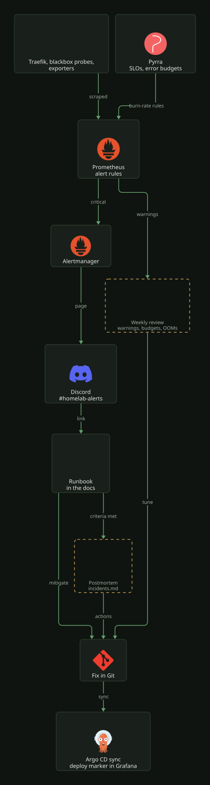

# Reliability practice

How the homelab is kept running: what is measured, what pages, what to do when something
pages, and how a week is reviewed. Each piece has its own page; this one shows how they fit.

## The pieces

| Piece | What it does | Where |
|---|---|---|
| SLOs and error budgets | the public sites, the gateway and the shared platform each have a 7-day objective, and the paging probe SLO alerts on burn rate | [slos.md](slos.md) |
| Alerts | only `critical` reaches Discord, and every rule links to its runbook section | [README.md](README.md#alert-path), [runbooks.md](runbooks.md) |
| Incidents | blameless postmortems, written when an event meets the criteria at the top of the page | [incidents.md](incidents.md) |
| Change tracking | every Argo CD sync is a deploy marker on the Homelab dashboards; Kargo holds a site's prod promotion for a manual merge when its budget is below 25 % | [argocd.md](../delivery/argocd.md#deploy-markers), [slos.md](slos.md#error-budget-policy) |
| Capacity | the NAS volume, Proxmox storages and PVCs page when they are on course to fill within 4 days, before the fixed thresholds fire | [runbooks.md](runbooks.md#persistentvolumefillingup) |
| Watching the watchers | the Cloudflare watchdog reports a missing Alertmanager heartbeat, the chart's Alertmanager rules catch a failed reload, split replicas or failed sends, `SLOMetricAbsent` fires when an SLO loses its metric, and every exporter has a `*MetricsDown` alert | [README.md](README.md#alert-path) |

## What pages

An alert is `critical`, and so reaches Discord, only when someone has to act within hours:
something users can see is down, data is at risk, or a safety net (backups, the alerting
path itself) has stopped. Everything else is `warning`: recorded in Prometheus, never sent,
and read in the weekly review. A false positive is fixed by tuning the rule or its upstream
macro, not by raising the threshold until it is quiet.

A new alert needs a section in [runbooks.md](runbooks.md), a `runbook_url` pointing at it,
and a row in the alert table in [README.md](README.md#alerts).

## When something pages

1. Open the runbook link in the Discord message and follow it.
2. Mitigate before diagnosing. For a bad release, revert the promotion commit or roll the
   app's image back in Git and let Argo CD sync; a restart is fine when the runbook says so.
3. On Homelab-SPOG, look for a deploy marker shortly before the first symptom. Hovering it
   names the app and the commit.
4. If the event meets the criteria in [incidents.md](incidents.md), write the postmortem
   there, ending with actions that make the next occurrence shorter or impossible.

## Weekly review

Fifteen minutes, once a week. The queries run in Grafana's Explore against Prometheus.

| Question | Where | Act when |
|---|---|---|
| What fired, including warnings? | `group by (alertname, severity) (max_over_time(ALERTS{alertstate="firing"}[7d]))` | a critical that needed no action: tune it; a warning that needed action: make it critical |
| How much budget did each SLO spend? | [Pyrra](https://pyrra.local.bigd.no), and the "SLOs & error budgets" row on Homelab-SPOG | a budget below 25 %: find the cause before the next promotion |
| What was OOM-killed? | `group by (namespace, pod, container) (max_over_time(kube_pod_container_status_last_terminated_reason{reason="OOMKilled"}[7d]) == 1)` | any result: see the memory rule below |
| What runs close to its memory limit? | `max by (namespace, pod, container) (max_over_time(container_memory_working_set_bytes{container!="", container!="POD"}[7d])) / max by (namespace, pod, container) (kube_pod_container_resource_limits{resource="memory"}) > 0.8` | above 0.8: raise the limit before it is killed |
| What keeps restarting? | `sum by (namespace, pod, container) (increase(kube_pod_container_status_restarts_total[7d])) > 3` | any result: read its logs on Homelab-Log-SPOG |
| What fills within a month? | `predict_linear(kubelet_volume_stats_available_bytes{job="kubelet"}[1d], 30 * 86400) < 0` | any result: expand the PVC or cut retention |
| Which postmortem actions are open? | `grep -n -- "- \[ \]" docs/platform/observability/incidents.md` | an action older than a month: do it or drop it in the postmortem |

## Memory limits

Set a container's memory limit from its 7-day peak working set plus room for its own spikes,
not from its idle use. Query engines spike well above their steady state: a heavy Grafana
dashboard adds over 100Mi, and a Tempo search 500Mi or more. The request matches the steady
working set, so the scheduler places the pod on a node that really has the memory.
