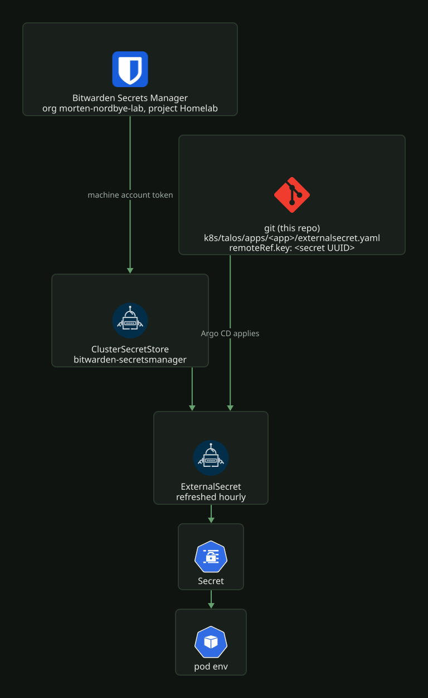
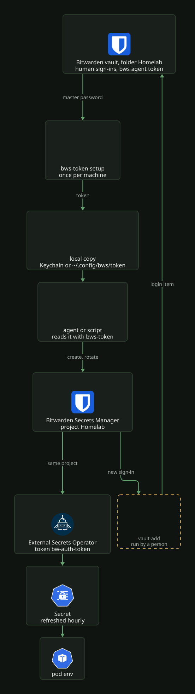

# Secrets: Bitwarden to cluster

No secret value is committed to this repo. Git holds references only. Each app
declares an `ExternalSecret` that names a Bitwarden Secrets Manager item by
UUID. External Secrets Operator (ESO) turns that into a Kubernetes `Secret`
inside the cluster and refreshes it every hour. The values live in two places only:
Bitwarden and the running cluster.

[](../../assets/diagrams/secrets-flow.svg)

## The in-cluster half

`k8s/talos/infra/external-secrets-operator/` deploys ESO and the
`bitwarden-sdk-server` chart. The Bitwarden provider does its crypto in that
separate service. ESO reaches it over TLS with a certificate from cert-manager.
`bitwarden-certificate.yaml` and `cluster_issuer.yaml` provide that certificate.

`clustersecretstore-bitwarden.yaml` defines the single store that all apps use:

- Its name is `bitwarden-secretsmanager`. It is scoped to org
  `1a1f473f-c6a3-47af-a106-b29800f5ca1f` (`morten-nordbye-lab`) and project
  `1ea61322-5f4a-44a4-b4d0-b29b00ba1134` (the `Homelab` project).
- It authenticates with a machine account access token that it reads from the
  `bw-auth-token` Secret in the `external-secrets` namespace. That token is the
  one secret this pattern cannot manage for itself. It is applied by hand once
  (`kubectl create secret generic bw-auth-token -n external-secrets
  --from-literal=token=...`) and never reaches git. Its recreation is therefore
  part of a cluster rebuild.

## Access model

Two stores, split by who reads the value:

| Store | Holds | Read by |
|---|---|---|
| Secrets Manager project `Homelab` | everything a cluster workload, script or agent reads, including laptop-only device keys | ESO, the agent |
| Bitwarden vault, folder `Homelab` | human sign-ins, and the agent's bootstrap token | Morten |

[](../../assets/diagrams/secrets-agent.svg)

One machine account, `Homelab`, has read and write access on the project. Each consumer
gets its own access token on that account. The cluster token is stored as `bw-auth-token`.
The `agent` token is for AI agents and scripts on a workstation. If you revoke one token,
the other still works. All tokens share the write access of the account, so the cluster
token can also edit secrets. Grants are at project level, so a new secret needs no grant
of its own. Agents never unlock the vault.

The `agent` token is stored once, as the vault login `bws agent token`
(password field). The vault syncs it to every device. Each machine keeps a local copy that
[`ai/skills/secrets/bws-token`](../../../ai/skills/secrets/bws-token) reads. The copy is
the macOS Keychain item `bws-agent`, or `~/.config/bws/token` (mode 600) on other
systems, or `$BWS_ACCESS_TOKEN` when it is set. Cloud agent sessions get the token through
the variable. A new machine needs one command in a terminal. The command asks for the
master password:

```bash
ai/skills/secrets/bws-token setup
```

It copies the vault item into the local store and checks the token against the API. It
puts `bws-token` and `vault-add` on PATH in `~/.local/bin`. It also links the skill into
the global skill folder of each installed agent, so other repos get it. To rotate the
token, create a new access token named `agent` on the `Homelab` machine account in the
Secrets Manager web app. Replace the password of the vault item, and run `setup` again on
each machine.

## Creating a secret

Use the Bitwarden Secrets Manager CLI, `bws`. It is installed at
`/opt/homebrew/bin/bws` from the GitHub release binary. The brew package
`bitwarden-cli` is the Password Manager tool, `bw`.

```bash
export BWS_ACCESS_TOKEN=$(bws-token)

bws secret create trek-encryption-key "$(openssl rand -hex 32)" \
  1ea61322-5f4a-44a4-b4d0-b29b00ba1134 \
  | python3 -c "import json,sys; d=json.load(sys.stdin); print(d['id'])"
```

Conventions, the same as the existing items:

- Names are lowercase kebab-case and describe the consumer
  (`authentik-secret-key`, `trek-encryption-key`). The Bitwarden name is
  independent of the k8s `secretKey`, which is usually SCREAMING_SNAKE_CASE.
- Notes stay empty.
- Generate values in a subshell, as above. Then they never reach the terminal
  scrollback, the shell history or a chat transcript.

The printed `id` is the UUID that the ExternalSecret references. UUIDs are safe to
commit, because they are useless without a token. Never run `bws secret list`
or `bws secret get` without a filter. The JSON includes every plaintext value.
Filter to the harmless fields:

```bash
bws secret list | python3 -c "
import json,sys
for s in json.load(sys.stdin): print(s['id'], s['key'])"
```

## Wiring it into an app

The app directory gets an `ExternalSecret` (copy `k8s/talos/apps/trek/externalsecret.yaml`):

```yaml
apiVersion: external-secrets.io/v1
kind: ExternalSecret
metadata:
  name: trek-secret
  namespace: trek
spec:
  refreshInterval: 1h
  secretStoreRef:
    name: bitwarden-secretsmanager
    kind: ClusterSecretStore
  target:
    name: trek-secret
    creationPolicy: Owner
  data:
    - secretKey: ENCRYPTION_KEY
      remoteRef:
        key: "9c266643-4f45-4aca-8586-b4b8006e6d3b"   # the bws-returned UUID
```

The Deployment reads the resulting Secret in the normal way
(`valueFrom.secretKeyRef`). ArgoCD applies both. Nothing is done by hand in
the cluster.

## Rotation and refresh

Rotate with `bws secret edit <uuid> --value ...`. The UUID stays the same after an
edit, so no manifest change is needed. Only a delete and recreate of the item
changes the UUID.

App ExternalSecrets sync on a 1 hour `refreshInterval`. A new value reaches
the cluster Secret within the hour. To sync at once, run
`kubectl annotate externalsecret <name> -n <ns> force-sync=$(date +%s) --overwrite`.

Pods read the new value at their next restart. Reloader
(`k8s/talos/infra/reloader/`) watches all namespaces. It restarts a workload
automatically when the workload carries `reloader.stakater.com/auto: "true"`.
gluetun-vpn, logeverylift and reelsmith carry it. A workload without the annotation
needs a `kubectl rollout restart`.

## Gotchas

- The Bitwarden API answers 404, not 403, when a machine account writes to a
  project that it can only read. A `bws secret create` that fails with "Resource not
  found" almost always means that the project grant is read-only, not that the
  project id is wrong.
- An ExternalSecret that stays in `SecretSyncedError` with no clear cause usually
  means that the ESO machine account cannot see the item. Check that the `Homelab`
  account still has its project-level read grant.
- `bws project list` that returns `[]` does not mean that the token is broken.
  Secret reads can still work. Test access with `bws secret list` (filtered) instead.
- `bitwarden-sdk-server` reads its TLS cert into memory at startup and never
  reloads it. It serves the cert from the `bitwarden-tls-certs` Secret. That Secret is
  also the CA that the ClusterSecretStore trusts (`caProvider`). When cert-manager
  renews that Secret, a pod that still holds the old cert fails every ExternalSecret in
  the cluster with x509 errors. Reloader restarts the Deployment on a change to
  that Secret (`secret.reloader.stakater.com/reload` in
  `k8s/talos/infra/external-secrets-operator/values.yaml`). If x509 errors appear
  after a renewal anyway, check that the annotation is still on the Deployment. Then
  run `kubectl rollout restart deploy/bitwarden-sdk-server -n external-secrets`.

## Sign-ins created by an agent

When an agent creates a human login, such as the admin account of an app, it generates
the password into the `Homelab` project. It then hands over a complete command:

```bash
vault-add "<App> admin" <username> <bws-secret-id> https://<app-url>
```

The human runs it. It unlocks the vault, creates a login in the `Homelab` folder from the
Secrets Manager value, and prints only the item name and id.

## Device credentials

Credentials for LAN devices that the laptop controls, and never the cluster, live in
the `Homelab` project like everything else. Any machine with the agent token can then use
them. A gitignored `*.env` file at the repo root exports them by reference.

The Hue bridge is the example. `hue.env` holds the bridge address and
resolves the key when you source it:

```bash
export HUE_APPLICATION_KEY="$(BWS_ACCESS_TOKEN=$(bws-token) bws secret get <uuid> --output json | jq -r .value)"
```

The key is never written to disk, committed or shown in an agent transcript.
`**/*.env` is gitignored, so a new file must have the name `<thing>.env`. The
pattern does not match `.env.<thing>`.

To create the Hue key, press the round link button on top of the bridge and run this
command within 30 seconds. It prints the UUID for `hue.env`. To replace an existing key,
use `bws secret edit <uuid> --value {}` instead of `create`.

```bash
export BWS_ACCESS_TOKEN=$(bws-token)
curl -sk -X POST https://10.3.10.16/api -H 'Content-Type: application/json' \
    -d '{"devicetype":"homelab#workstation"}' \
  | jq -r '.[0].success.username // empty' \
  | xargs -I{} bws secret create homelab-hue-app-key {} 1ea61322-5f4a-44a4-b4d0-b29b00ba1134 \
  | jq -r .id
```

Revoke it with `DELETE /api/<key>/config/whitelist/<key>`. A press on the link
button does not invalidate existing keys, so a new pairing never breaks the Home
Assistant integration's own key.
