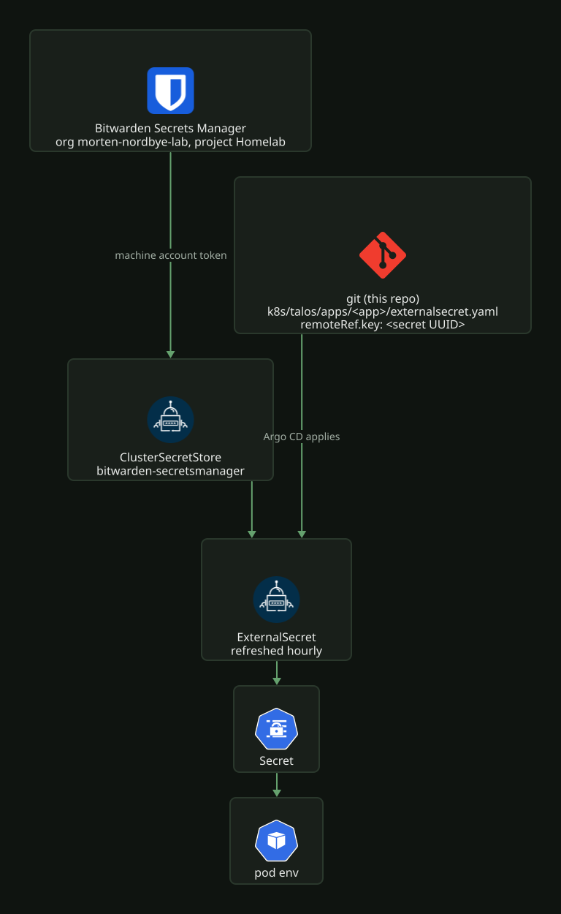

# Secrets: Bitwarden to cluster

No secret value is committed to this repo. Git holds references: each app
declares an `ExternalSecret` that names a Bitwarden Secrets Manager item by
UUID, and External Secrets Operator (ESO) turns that into a Kubernetes `Secret`
inside the cluster, refreshed hourly. The values live in two places only, Bitwarden and the
running cluster.

[](../../assets/diagrams/secrets-flow.svg)

## The in-cluster half

`k8s/talos/infra/external-secrets-operator/` deploys ESO plus the
`bitwarden-sdk-server` chart. The Bitwarden provider does its crypto in that
separate service, reached over TLS with a cert-manager-issued cert, which is
what `bitwarden-certificate.yaml` and `cluster_issuer.yaml` are for.

`clustersecretstore-bitwarden.yaml` defines the single store all apps use:

- name `bitwarden-secretsmanager`, scoped to org
  `1a1f473f-c6a3-47af-a106-b29800f5ca1f` (`morten-nordbye-lab`) and project
  `1ea61322-5f4a-44a4-b4d0-b29b00ba1134` (the `Homelab` project).
- It authenticates with a machine account access token read from the
  `bw-auth-token` Secret in the `external-secrets` namespace. That token is the
  one secret this pattern cannot manage for itself. It is applied by hand once
  (`kubectl create secret generic bw-auth-token -n external-secrets
  --from-literal=token=...`) and never lands in git, so recreating it is part
  of a cluster rebuild.

## Access model

Two stores, split by who reads the value:

| Store | Holds | Read by |
|---|---|---|
| Secrets Manager project `Homelab` | everything a cluster workload, script or agent reads, including laptop-only device keys | ESO, the agent |
| Bitwarden vault, folder `Homelab` | human sign-ins, and the agent's bootstrap token | Morten |

One machine account, `Homelab`, has read and write on the project, and each consumer
gets its own access token on it: the cluster's lives as `bw-auth-token`, and the `agent`
token is for AI agents and scripts on a workstation. Revoking one token leaves the other
working. All tokens share the account's write access, so the cluster's token can edit
secrets too. Grants are project-level, so a new secret needs no per-secret grant.
Agents never unlock the vault.

The `agent` token is stored once, as the vault login `bws agent token`
(password field), which syncs to every device. Each machine keeps a local copy that
[`ai/skills/secrets/bws-token`](../../../ai/skills/secrets/bws-token) reads: the macOS
Keychain item `bws-agent`, `~/.config/bws/token` (mode 600) elsewhere, or
`$BWS_ACCESS_TOKEN` when set, which is how cloud agent sessions get it. A new machine
needs one command in a terminal, which prompts for the master password:

```bash
ai/skills/secrets/bws-token setup
```

It copies the vault item into the local store, checks the token against the API, and
puts `bws-token` and `vault-add` on PATH in `~/.local/bin`, and links the skill into the
global skill folder of each agent installed, so other repos get it. To rotate the
token, create a new access token named `agent` on the `Homelab` machine account in the Secrets Manager web app, replace the
vault item's password, and rerun `setup` on each machine.

## Creating a secret

Use the Bitwarden Secrets Manager CLI, `bws`, installed at
`/opt/homebrew/bin/bws` from the GitHub release binary (brew's `bitwarden-cli`
is the Password Manager tool, `bw`).

```bash
export BWS_ACCESS_TOKEN=$(bws-token)

bws secret create trek-encryption-key "$(openssl rand -hex 32)" \
  1ea61322-5f4a-44a4-b4d0-b29b00ba1134 \
  | python3 -c "import json,sys; d=json.load(sys.stdin); print(d['id'])"
```

Conventions, matching the existing items:

- Names are lowercase kebab-case describing the consumer
  (`authentik-secret-key`, `trek-encryption-key`). The Bitwarden name is
  independent of the k8s `secretKey`, which is usually SCREAMING_SNAKE_CASE.
- Notes stay empty.
- Generate values in a subshell as above so they never touch the terminal
  scrollback, shell history, or a chat transcript.

The printed `id` is the UUID the ExternalSecret references; UUIDs are safe to
commit because they are useless without a token. Never run `bws secret list`
or `bws secret get` unfiltered, since the JSON includes every plaintext value.
Filter down to the harmless fields:

```bash
bws secret list | python3 -c "
import json,sys
for s in json.load(sys.stdin): print(s['id'], s['key'])"
```

## Wiring it into an app

The app directory gets an `ExternalSecret` (copy `k8s/talos/apps/trek/externalsecret.yaml`):

```yaml
apiVersion: external-secrets.io/v1
kind: ExternalSecret
metadata:
  name: trek-secret
  namespace: trek
spec:
  refreshInterval: 1h
  secretStoreRef:
    name: bitwarden-secretsmanager
    kind: ClusterSecretStore
  target:
    name: trek-secret
    creationPolicy: Owner
  data:
    - secretKey: ENCRYPTION_KEY
      remoteRef:
        key: "9c266643-4f45-4aca-8586-b4b8006e6d3b"   # the bws-returned UUID
```

The Deployment consumes the resulting Secret the normal way
(`valueFrom.secretKeyRef`). ArgoCD applies both; nothing is done by hand in
the cluster.

## Rotation and refresh

Rotate with `bws secret edit <uuid> --value ...`. The UUID is stable across
edits, so no manifest change is needed. Only deleting and recreating the item
changes the UUID.

App ExternalSecrets sync on a 1 hour `refreshInterval`, so a new value reaches
the cluster Secret within the hour. To hurry it along, run
`kubectl annotate externalsecret <name> -n <ns> force-sync=$(date +%s) --overwrite`.

Pods read the new value on their next restart. Reloader
(`k8s/talos/infra/reloader/`, watching all namespaces) restarts a workload
automatically when it carries `reloader.stakater.com/auto: "true"`, as
gluetun-vpn, logeverylift and reelsmith do. Anything without the annotation
needs a `kubectl rollout restart`.

## Gotchas

- Bitwarden's API answers 404, not 403, when a machine account writes to a
  project it can only read. A `bws secret create` failing with "Resource not
  found" almost always means the project grant is read-only, not that the
  project id is wrong.
- An ExternalSecret stuck in `SecretSyncedError` with no obvious cause usually
  means the ESO machine account cannot see the item. Check that the `Homelab`
  account still has its project-level read grant.
- `bws project list` returning `[]` does not mean the token is broken; secret
  reads can still work. Judge access by `bws secret list` (filtered) instead.
- `bitwarden-sdk-server` reads its TLS cert into memory at startup and never
  reloads it. It serves the cert from the `bitwarden-tls-certs` Secret, which is
  also the CA the ClusterSecretStore trusts (`caProvider`). When cert-manager
  renews that Secret, a pod that kept the old cert fails every ExternalSecret in
  the cluster with x509 errors. Reloader restarts the Deployment on a change to
  that Secret (`secret.reloader.stakater.com/reload` in
  `k8s/talos/infra/external-secrets-operator/values.yaml`). If x509 errors show
  up after a renewal anyway, check the annotation is still on the Deployment and
  run `kubectl rollout restart deploy/bitwarden-sdk-server -n external-secrets`.

## Sign-ins created by an agent

When an agent creates a human login, such as an app's admin account, it generates the
password into the `Homelab` project and hands over a filled-in command:

```bash
vault-add "<App> admin" <username> <bws-secret-id> https://<app-url>
```

Run by the human, it unlocks the vault, creates a login in the `Homelab` folder from the
Secrets Manager value, and prints only the item name and id.

## Device credentials

Credentials for LAN devices driven from the laptop, and never from the cluster, live in
the `Homelab` project like everything else, so any machine with the agent token can use
them. A gitignored `*.env` file at the repo root exports them by reference.

The Hue bridge is the worked example. `hue.env` holds the bridge address and
resolves the key at source time:

```bash
export HUE_APPLICATION_KEY="$(BWS_ACCESS_TOKEN=$(bws-token) bws secret get <uuid> --output json | jq -r .value)"
```

The key is never written to disk, committed, or shown in an agent transcript.
`**/*.env` is gitignored, so a new file must be named `<thing>.env`; the
pattern does not catch `.env.<thing>`.

To create the Hue key, press the round link button on top of the bridge and run this
within 30 seconds. It prints the UUID for `hue.env`; to replace an existing key, use
`bws secret edit <uuid> --value {}` instead of `create`.

```bash
export BWS_ACCESS_TOKEN=$(bws-token)
curl -sk -X POST https://10.3.10.16/api -H 'Content-Type: application/json' \
    -d '{"devicetype":"homelab#workstation"}' \
  | jq -r '.[0].success.username // empty' \
  | xargs -I{} bws secret create homelab-hue-app-key {} 1ea61322-5f4a-44a4-b4d0-b29b00ba1134 \
  | jq -r .id
```

Revoke it with `DELETE /api/<key>/config/whitelist/<key>`. Pressing the link
button does not invalidate existing keys, so re-pairing never breaks the Home
Assistant integration's own key.
